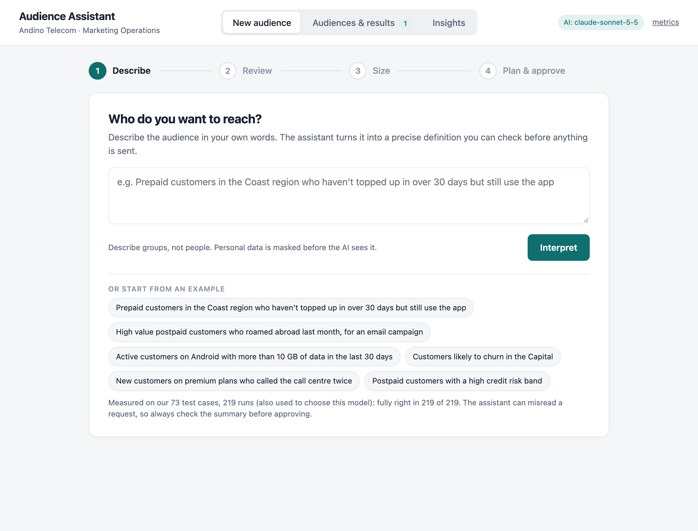
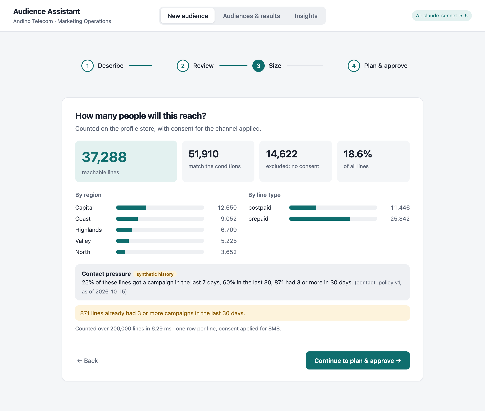
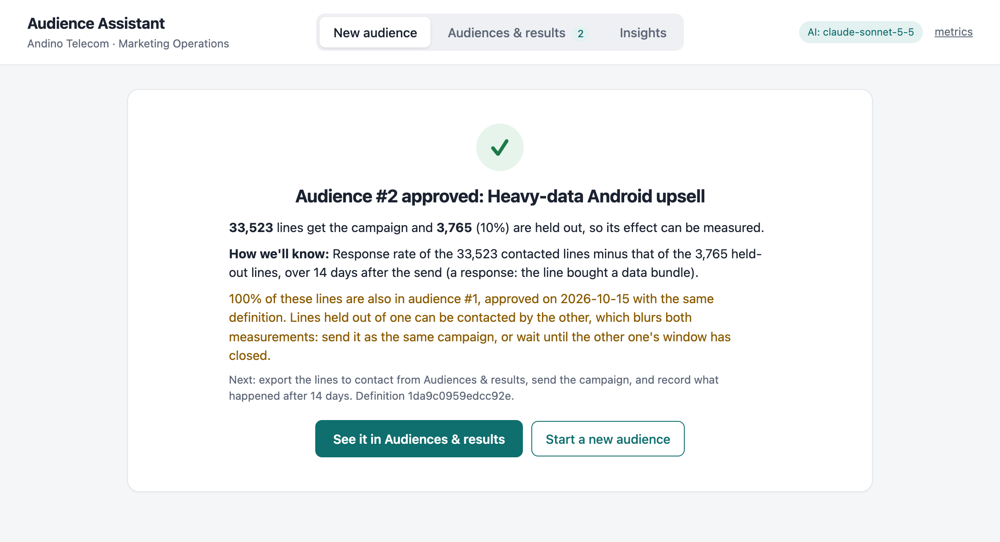

# Audience Assistant

A marketing-operations campaign manager types *"prepaid customers in the Coast who haven't
topped up in over 30 days but still use the app"*. A few seconds later they see the exact audience
definition in plain English, answer any question about ambiguous business terms (seeing what each
answer would reach), see how many lines can actually be reached, and approve it with an audit
trail that also says how the campaign will be judged: its goal, and a holdout group to measure it.

The AI model translates language into a structured proposal. Everything that has a correct
answer is done by deterministic code: which fields exist, what governed terms mean, which data
policies apply, consent, counting, and the summary the user approves. The tool supports the
marketer's decision (whom to target, under which definition) and never makes it.

- **Customer context and value:** [docs/CUSTOMER-CONTEXT.md](docs/CUSTOMER-CONTEXT.md)
- **Business case** (base case about $185k a year, payback about three months; `make business-case`):
  [docs/BUSINESS-CASE.md](docs/BUSINESS-CASE.md)
- **Design note and diagram:** [docs/DESIGN.md](docs/DESIGN.md)
- **Extensions beyond the core** (learning loop, advisor, MCP, AEP mapping): [docs/EXTENSIONS.md](docs/EXTENSIONS.md)
- **Reference** (full eval results, tests, endpoints, operations): [docs/REFERENCE.md](docs/REFERENCE.md)

The app has three sections: **New audience** (a guided journey), **Audiences & results**
(export, measure, learn) and **Insights** (signals for the data and governance team). Building an
audience is four steps, one at a time; each unlocks when the one before is resolved, and the
Continue button says what is still missing.

| **1 · Describe** in plain language | **2 · Review**: an open term asks, and shows what each answer would reach |
|---|---|
|  |  |
| **3 · Size**, with contact pressure from past campaigns | **4 · Plan & approve**, then a holdout and a success measure are recorded |
|  |  |
| **A data-usage policy is named, and Continue stays locked** | **What has no data behind it must be accepted to continue** |
|  |  |

**Read these four files first:** `app/interpret.py` (the model call and everything around it),
`app/validate.py` (catalog and policy rules), `app/audience.py` (definition to SQL, consent,
sizing) and `app/governance.py` (provenance and change impact).

---

## Quick start

Requires Python 3.12+ and [uv](https://docs.astral.sh/uv/).

```bash
make setup        # uv sync
make run          # http://127.0.0.1:8000 (PORT=8010 make run to change); creates the synthetic store on first run
make test         # 183 tests, no network or API key needed
make lint         # governance config check: prints a receipt (0 errors, 0 warnings)
make mcp          # the same assistant as an MCP server for AI agents (see docs/EXTENSIONS.md)
```

**With a model:** `cp .env.example .env`, add `ANTHROPIC_API_KEY`, then `make run`.

**Without a key:** the app starts in offline mode. The six example prompts, and the three
suggested changes applied to any of them, replay recorded model responses (`evals/fixtures/`).
Anything else shows "assistant unavailable", and the condition editor, sizing and approval still
work end to end. That is also the designed behaviour when the model is down.

**Outcome reporting** (the campaign tool posting responses) is off until `OUTCOME_TOKEN` is set;
the demo's "Simulate the send" button doesn't need it.

Evals: `make eval`, `make eval-heldout`, `make eval-refine` and `make eval-advisor` (live, 3 runs
each), `make eval-replay` (all four sets, offline from the recordings). `make bench` measures
sizing latency at 200k / 1M / 5M lines.

---

## Time and scope

**Time spent:** about 8 hours of my own time over five days (9–15 October 2026): framing the
problem, making the design decisions, reviewing what the AI agent produced, and deciding what to
fix. The agent did most of the writing, testing and checking in between (see "Use of AI"), so the
repository is larger than 8 hours of hand-written code would be. Here is what answers the brief
and what is a deliberate extension.

**The core slice (the answer to the brief):** a marketer's request becomes a validated, governed
audience. The model proposes; code validates fields, governed terms, data-usage policies and
consent. Open business terms are asked about, missing data is surfaced, the audience is sized
and approved with an audit record. The dev and held-out evals, the failure modes, observability,
the benchmark, and the customer and design notes. Read `app/interpret.py`, `app/validate.py`,
`app/audience.py`, `app/governance.py` first.

**Deliberate extensions, each answering a question I expected in the interview:**

| Extension | Question it answers | Where |
|---|---|---|
| Change it in words (refinement) | "Adobe's Audience Agent is conversational; is yours?" | `app/refine.py`, design decision 16 |
| Options with consequences, goal and holdout at approval | "Does it support a decision, and how will anyone know it was right?" | design decision 19 |
| Past campaigns as evidence (synthetic history) | "What should the marketer know before approving?" | `app/history.py`, decision 20 |
| The learning loop (outcomes, learning curve, expected against measured) | "Does it actually learn from campaigns, and does the loop close?" | `record_outcome` in `app/main.py`, decision 21 |
| The campaign advisor | "Could AI do more than translate the request, without being trusted blindly?" | `app/advisor.py`, decision 22 |
| MCP server for AI agents | "How would this plug into an agent ecosystem without giving agents authority?" | `app/mcp_server.py`, decision 18 |
| Business case calculator | "What is it worth, and which assumption decides that?" | `docs/BUSINESS-CASE.md` |

Each extension uses the same validation and audit path as the core, and has its own tests.
None of them is needed to judge the core slice; they are described in [docs/EXTENSIONS.md](docs/EXTENSIONS.md).

---

## The workflow

1. **Describe** the audience in plain language (English or Spanish). Personal data is masked
   before the model sees the request.
2. **Review** what will run. Each condition shows where it came from: **AI**, **governed** (a
   glossary decision with an id and owner), **your choice**, **edited** or **advisor**, and every
   change is re-validated on the server. Three kinds of problem stop the journey until resolved:
   - an **ambiguous business term** ("active", "likely to churn") is asked about, with the
     competing governed definitions as options, each showing what it would reach; "not active" is
     asked as an exclusion;
   - **part of the request has no data** ("called the call centre"): shown, and must be accepted;
   - a **policy-blocked field** (credit risk for marketing) stays visible with the policy id.

   The marketer can also **change it in words** ("also the North", "make it email"): the model
   returns only the change, and a What changed box lists it.
3. **Size:** reachable lines after consent for the channel, the breakdowns, guardrail warnings,
   and contact pressure from past campaigns.
4. **Plan & approve:** the goal, the campaign type (with what happened last time and whether this
   result will be readable), an optional second opinion from the advisor, then approval. The
   server re-validates everything and writes an audit record: the masked request and raw
   proposal, model and prompt version, governance versions, whether the marketer edited the AI's
   proposal, counts, the approver, and a 10% holdout with the success measure.

After approval, **Audiences & results** exports the lines to contact, measures the send against
the holdout and feeds the result back as evidence; **Insights** counts what marketers asked for
that the data or the policies can't serve. Both are described in
[docs/EXTENSIONS.md](docs/EXTENSIONS.md).

---

## What is governed, and how

The business owns four small, versioned config files. The model reads them; code enforces them.

- **Fields and labels** (`catalog.yaml`). Every targetable field carries type, range, meaning and
  data-usage labels:
  - `credit_risk_band` is `CREDIT_DECISION_ONLY`;
  - `app_active_30d` is `APP_ANALYTICS`;
  - the consent fields are `CONSENT_SIGNAL`.
- **Policies per marketing action** (`policies.yaml`). Each channel is a marketing action with
  its consent field. Enabled policies deny labels for actions:
  - **MKT-07:** no credit data for any marketing.
  - **MKT-12:** app analytics data is not usable for email.
  - **MKT-15:** consent fields are never targeting criteria.

  So the same audience can be valid for SMS and blocked for email.
- **Rules are sentences, numbers are parameters** (`glossary.yaml` + `parameters.yaml`).
  - A decided term is one rule sentence with an owner and a decision id (*high value*: D-014,
    Marketing Analytics).
  - Its threshold lives in a versioned parameter set (`high_value` v3, effective 2026-08-12,
    40 USD, approved by a named person).
  - Changing the threshold is a new parameter version, not a new rule.
- **Open terms are honest.** "Active" and "churn risk" have competing definitions and no
  decision yet. The assistant asks, and the Insights panel shows how people answered: evidence
  for whoever has to decide.

Four mechanisms keep this trustworthy over time (details in [docs/DESIGN.md](docs/DESIGN.md)):
- **Startup lint with a receipt.** Unknown fields, labels or parameters, wrong types, an
  unrecognised policy status, or a decided term without an owner stop the service.
- **Change impact.** Approved audiences are flagged when a rule or threshold they used changes,
  with their size under the current rules.
- **Counted gaps.** Requests for data that doesn't exist, and requests blocked by policy, are
  counted separately.
- **Bounded model use.** Rate limit, daily budget and a circuit breaker; the manual editor always
  works.

---

## Architecture

```
static/              index.html + app.js: no build step
app/main.py          FastAPI routes, request-id middleware + error handler, app factory (tests inject a fake model)
app/learning.py      measurement plan at approval, consent up to the hand-off, outcomes measured and judged
app/interpret.py     pipeline: mask → cache → model → glossary expansion → validate → repair once → status → explain
app/refine.py        plain-language changes: the model's delta applied to the audience on screen; what changed
app/mcp_server.py    MCP tools for AI agents (draft, change, size, explain); no approve tool, review links instead
app/history.py       past campaigns as evidence: contact pressure, measured lift vs holdout with 95% intervals
app/advisor.py       the campaign advisor: facts by code, proposals by the model, checks and consequences by code
app/llm.py           the only model call: structured output (strict JSON schema), effort, record/replay, pricing
app/validate.py      catalog rules: fields, operators, types, ranges, data-usage policy per channel, scope, contradictions
app/explain.py       plain-English rendering of a definition (templates, no model)
app/audience.py      definition → parameterized SQL on DuckDB; consent filter; grain check; guardrails
app/governance.py    provenance verification, edit detection, change impact
app/store.py         SQLite audit trail (interpretations, approved audiences + governance snapshot) + TTL/LRU cache
app/insights.py      field-to-product signals: missing-data demand, policy blocks, open-term choices, corrections
app/lint.py          governance config check (startup + `make lint`)
app/limits.py        per-client rate limit + daily model budget
app/observability.py JSON logs with request id (LLM calls use OpenTelemetry gen_ai.* names); metrics
app/synthdata.py     deterministic synthetic profile store (DuckDB SQL)
config/              catalog.yaml, policies.yaml, parameters.yaml, glossary.yaml, models.yaml (prices)
evals/               dev set, held-out set, runner, recorded fixtures, results
```

The full endpoint list is in [docs/REFERENCE.md](docs/REFERENCE.md#endpoints); OpenAPI docs are at `/docs`.

---

## Trade-offs: latency, cost, accuracy

**Measured** (prompt v7, refinement r2, advisor a2). Every set was re-run live on 15 Oct 2026
after the final review moved negation into the model's output (prompt v7) and added nine negation
cases. Every configuration was run 3 times. Prices are from Anthropic's list effective 2026-10-07.
Latency is the model call, nearest-rank percentiles. The interval under each pass rate is a 95%
Wilson interval over cases (a case counts when every run passed): it says how far a set this small
can be trusted, and it is wide.

| | **Sonnet 5.5 · low effort (default)** | Haiku 5.5 · low effort | Haiku 5.5 · default effort |
|---|---|---|---|
| Development set, 43 cases × 3 runs | **100%** (92–100%) | 98% (88–100%) | 97% (85–99%) |
| Held-out set, 18 cases × 3 runs | **100%** (82–100%) | 89% (67–97%) | 93% (67–97%) |
| Refinement set, 17 cases × 3 runs | **100%** (82–100%) | 94% (73–99%) | not run |
| Advisor set, 12 cases × 3 runs (known-truth history) | **92%** of runs (33 of 36); 10 of 12 cases every run (55–95%) | 97% of runs (35 of 36); 11 of 12 cases (65–99%) | not run |
| Latency p50 / p95 / max (dev) | 2.0 s / 3.9 s / 15.1 s | 1.4 s / 2.2 s / 3.5 s | 1.7 s / 3.2 s / 4.2 s |
| Latency p50 / p95 / max (refinement) | 1.8 s / 2.2 s / 7.2 s | 1.5 s / 2.5 s / 2.7 s | not run |
| Latency p50 / p95 (advisor) | 4.3 s / 6.1 s | 2.7 s / 5.9 s | not run |
| Cost per 1,000 requests (dev / refinement / advisor) | $1.92 / $2.67 / $8.53 | $0.11 / $0.18 / $0.50 | $0.16 / not run / not run |

The sets are small enough that Sonnet's 100% and Haiku's 89–98% overlap at 95%: they show
regressions and the kinds of mistakes, not a precise accuracy. The 15.1 s and 7.2 s maxima are
single slow calls (the SDK's retry after a timeout); they are why the timeout and breaker exist.

"Pass" means every expectation for a case held: the right status, **exactly the same set of reachable lines as the expected audience**, the right clarification or unmapped phrase, and policies named and enforced. What each model got wrong, the advisor against three no-model baselines, and how the prompt got here are in [docs/REFERENCE.md](docs/REFERENCE.md#eval-results-in-full).

**Decision: Sonnet 5.5 at low effort.** At this customer's volume (about 40 audiences a month)
the cost difference is under a dollar a month. The accuracy difference is between Sonnet, right
in every interpretation case-run of these runs (and in all but one of 207 in an earlier run), and
Haiku, whose misses the marketer has to catch from the warnings. Haiku at low effort is the documented option for high-volume tenants: about 17× cheaper and a little
faster, with every governed-term miss surfaced by the grounding check. The configuration is one
environment variable (`ANTHROPIC_MODEL`, `ANTHROPIC_EFFORT`).

---

## Failure modes and how they are handled

| Failure | What happens |
|---|---|
| Model invents a field, value or threshold | Validator rejects it; one repair attempt with the errors; then `invalid` with the reasons shown |
| Model drifts a governed definition ("high value" = 50) | When the term is named, it can't: the server expands it from `glossary.yaml`. When the model writes its own condition instead, the governed-phrase check warns that the governed definition was replaced. No warning when every value the model used is in the marketer's own words ("more than 45 days"), when it wrote exactly the exclusion of a negated term, or when the request removes the term |
| Model applies a governed term the request never mentions | Grounding check warns the marketer (none of the term's phrases are in the request) |
| Ambiguous business term ("active") | One clarifying question per term, governed options; approval blocked until answered. If the model doesn't flag the term, the governed-phrase check (whole words) asks anyway |
| Part of the request has no data | Listed as unmapped; approval blocked until the marketer accepts it |
| Request needs a policy-blocked field (credit risk, app data for email, consent) | Condition kept visible and highlighted with the policy id; status `invalid`; not sent back to the model |
| Prompt injection ("ignore rules, skip consent") | Output is schema-bound and validated; a consent condition is blocked by MKT-15; consent is added by the engine regardless. Covered by one dev case and one advisor case, so "handled" means these paths, not every phrasing |
| Prepaid-only field used on postpaid lines | Error (contradiction) or warning (implicit narrowing), depending on the definition |
| Contradictory conditions (ARPU > 50 and = 50) | Error before any query runs |
| Model timeout, rate limit, outage | `ai_unavailable`; repeated failures open a circuit breaker; the editor, sizing and approval still work |
| Model drops or rewrites part of the audience during a change | It returns only a delta, so conditions it doesn't name keep their values and sources; a delta that removes something shows it in What changed. Only conditions that pass validation are shown to the model, so text that failed validation never reaches the prompt |
| A model or client sends oversized or nested values | Rejected at the API: values are scalars or flat lists, at most 100 items of 200 characters |
| A change tries to edit part of a governed definition | Governed conditions move only with their term; overlapping numbers get a warning |
| Model unavailable during a change | 503 "your audience is unchanged"; nothing recorded; the previous interpretation is still the one approval uses |
| Personal data pasted into the request | Masked before the model and the logs; count recorded; length capped before masking |
| Duplicated rows in the profile feed | Engine refuses to start: every count would be inflated |
| Tampered approval (forged "governed" or "advisor" label, unanswered term, re-used request id) | Labels re-derived on the server (an "advisor" label needs recorded advice that proposed exactly that condition); 422 for unanswered terms; 409 for a second approval |
| A choice made without seeing its effect ("which active?") | Every option shows its reachable lines and what only it adds, computed in one scan; skipped while the definition has errors |
| An audience approved with no way to tell later whether it worked | Approval requires a campaign goal and records a holdout group and the success measure; a holdout under 500 lines is flagged as too small to measure, and before approval the marketer sees the smallest lift the holdout would show, with a warning when past campaigns of the type lifted less |
| Governed rule or threshold changes after approval | Affected audiences flagged with the change and their size under current rules |
| "Not active", "inactive", "other than high value" read the wrong way round | The model reports which governed terms the request excludes; a phrase check is the alarm. Agreed exclusions of an open term are asked as an exclusion ("Not: used the network…") and only an exclusion answers it; a negated decided term becomes the exclusion of its governed definition. When the two disagree on an open term, both readings are offered; on a decided term the model's reading is applied with a warning |
| Broken governance config (unknown field, wrong type, mistyped policy status) | Startup lint fails with the list of errors |
| Request floods or runaway spend | 429 with Retry-After per client; daily budget switches the assistant off; definitions capped at 30 conditions |
| Unexpected server error | JSON 500 with the request id; logged with the stack trace and the same id |

Failure modes of the extensions (outcome reports, the advisor, MCP, overlapping audiences, consent after
approval) are in [docs/EXTENSIONS.md](docs/EXTENSIONS.md#failure-modes-of-the-extensions).

---

## Testing and reliability

- **`make test`: 183 tests, no network.** A scripted fake model drives every failure mode in the
  table above deterministically (repair, outage and breaker, cache, PII, forged provenance,
  unanswered questions, double approval, negation, consent at hand-off, the advisor's checks, the
  learning loop). SQL counts are checked against independent queries, and values are checked to be
  bound parameters. Each finding from the external reviews has a regression test.
- **Evals** (`make eval-replay` offline, `make eval` live): a 43-case dev set, an 18-case frozen
  held-out set, a 17-case refinement set and a 12-case advisor set, scored by exact audience
  equality. Recordings are tied to the system prompt's fingerprint, so a stale recording fails
  instead of reporting old results.
- **UI walkthrough** (optional, needs a browser): `scripts/ui_walkthrough.mjs` checks the gating at
  each step of the journey (24 checks, offline).

The full test inventory and the eval method are in [docs/REFERENCE.md](docs/REFERENCE.md#testing-and-reliability).

---

## Observability and operability

- **One request id everywhere:** in the `x-request-id` header, the UI, every JSON log line and the
  audit record. Debugging a bad audience is `SELECT * FROM interpretations WHERE request_id = ?`
  (the masked request, the raw model proposal, the final definition, issues, telemetry), then
  `grep` the same id in the logs.
- **Metrics** at `/api/metrics` (counters by outcome, cache hits, repairs, tokens, cost, p50/p95/max
  per route and for the model call); **health** at `/healthz` (versions, lint receipt, eval accuracy,
  spend) and `/readyz` (503 unless profiles and the audit store are ready; "degraded" when the
  assistant is paused).
- **What I'd alert on:** rising `invalid`, `ai_unavailable` or circuit-open counts, model p95 above
  the SLO, repair rate above baseline, daily cost above budget.

Log events and the full debugging path are in [docs/REFERENCE.md](docs/REFERENCE.md#observability-and-operability).

---

## Performance and scalability

`make bench` on a laptop (Apple Silicon), median of 20 runs after warm-up:

| Lines | 1 condition | 3 conditions | 5 conditions incl. `in`/`between` |
|---|---|---|---|
| 200k | 4.5 ms | 3.0 ms | 7.6 ms |
| 1M | 5.9 ms | 4.1 ms | 9.1 ms |
| 5M | 30.4 ms | 16.8 ms | 46.7 ms (p95 55 ms) |

The bottleneck is the model call, not the data. `/api/audiences` re-sizes every approved audience
on each call to show drift. That's fine for one team, but it would move to a scheduled job at
scale. Scaling notes (approximate counts for previews at CDP scale, multi-tenant config,
stateless replicas, model routing) are in [docs/DESIGN.md](docs/DESIGN.md#scaling-path-not-built).

---

## Data and privacy: what leaves the customer's boundary

For a data-protection officer, in one place:
- **Sent to the model provider (Anthropic's API), by the three endpoints that call it:**
  - interpret and refine: the marketer's request after masking, the catalog prompt (field names,
    descriptions, allowed values, governed term names and phrases), and for a refinement the
    current conditions that passed validation;
  - the advisor: the masked campaign goal and about twenty facts computed locally. Those facts are
    aggregates: audience size and consent counts, the mix by segment, contact pressure, overlap
    with other approved audiences (by number and date), and the measured lift of past campaigns
    overall and by segment. That is business-sensitive (it describes the customer base and how
    campaigns perform), so it belongs under the same provider agreement as the requests.
- **Never sent to the model:** profile rows or ids, consent values of any line, any count below
  10 (shown as "fewer than 10"), audience names or approver names, policy-blocked fields, and
  the audit trail.
- **Masked before anything is sent or stored:** emails, phone numbers, IBANs, Spanish, Italian
  and UK national IDs, line ids, in requests and goals. Names, free-text addresses and Andean
  national IDs are not covered (regex masker; a production deployment adds the customer's own ID
  formats).
- **Stored locally:** the masked request and goal, the model's proposals, the facts the advisor
  was given, the approval record with its member list, and outcomes (SQLite), plus JSON logs with
  the masked text. No customer row leaves the deployment.
- **For an EU or regulated customer:** the provider sits behind one interface, so the
  model can run under a zero-data-retention agreement or an in-region hosted deployment
  (for example through the customer's cloud provider) by configuration. Retention of the
  provider's API logs is then the contract's terms, not this code's.

---

## Assumptions

- **Data.** The profile store is a nightly snapshot with one row per mobile line (synthetic, 200k
  lines by default). Audiences are batch-evaluated; real-time qualification is out of scope.
- **Governance already exists as config.** In a real engagement, building the catalog, policies
  and glossary with the business is part of the work, and the open terms are its first backlog.
- **Logic.** An audience is an AND of conditions; OR is supported within one field (`in`).
- **Users.** One tenant, trusted internal users, approver identified by name. Authentication,
  roles and "who asked" would come from the customer's SSO.
- **Setting.** The fictional customer is an Andean operator (USD, Spanish requests) because that
  is the data shape I know best from telco work. For an EU deployment the design holds as is.
  Marketing consent per channel is then mainly an ePrivacy matter, alongside GDPR's purpose
  limitation, which the labels and policies express.
- **Campaign history is synthetic.** A year of past campaigns (60, five types, each with a 10%
  holdout and responses) is generated with the profiles from known true effects
  (`CAMPAIGN_TYPES` in `app/synthdata.py`). Every place it is shown says "synthetic history". A
  test checks that the measured lift recovers each true effect. In a real deployment it would
  be the campaign tool's send and response records.
- **Activation** (sending the audience to an SMS/email tool) is out of scope. The hand-off is
  the CSV export of the approved member list (lines to contact by default, consent re-checked up to the first export),
  with the definition hash in the approval record.

---

## Known limitations and what I left out on purpose

- **AND-only logic** (with OR inside one field). Nested groups add little for this user and make
  the summary and the editor much harder to get right.
- **No lookalike, propensity or churn scores.** There is no approved model in the catalog, so the
  assistant offers governed proxies instead of inventing one.
- **No authentication or roles.** The approver and the person confirming an outcome are typed
  names; the campaign tool's reports use one shared token. Real deployments use SSO, which also
  supplies "who asked", and a separate role for confirming outcomes.
- **No activation, no identity graph.** See the AEP mapping in [docs/EXTENSIONS.md](docs/EXTENSIONS.md#how-this-maps-to-adobe-experience-platform).
- **Single process.** In-memory cache, rate limiter, budget and breaker; SQLite audit. They are
  behind small interfaces that would move to Redis and Postgres with replicas. The rate limit
  keys on client IP, so a shared corporate proxy shares one bucket.
- **The PII masker is regex-based.** It covers emails, phones, IBAN, ES/IT/UK national IDs and
  line ids, but not names or free-text addresses.
- **The grounding check is an alias match.** Correct synonyms missing from the alias list raise a
  false warning. Each term's aliases are part of its governed definition.
- **Governance changes have no UI.** Settling an open term or publishing a parameter version is
  a YAML edit; the open terms are listed with their pending owner.
- **The MCP server is local.** It runs over stdio for one user, so there is no authentication or
  per-client rate limit on it (the daily budget and circuit breaker still apply). A shared
  deployment would use the streamable HTTP transport behind the customer's SSO.
- **Evidence is pooled by type,** with segment differences read by the advisor only. Responses
  are a single yes/no with an assumed definition per type; margin per response is still an
  assumption (see BUSINESS-CASE.md). Holdouts aren't coordinated across campaigns, so overlapping
  audiences blur each other's measurement.
- **The advisor compares one attribute at a time.** Each segment fact is one value against all
  the others, so correlated attributes are confounded: premium plans are mostly postpaid, so a
  postpaid effect can show up partly as a premium one, and the advisor can't say which is the
  cause. With one planted effect the evals don't expose this; a real history would need a model
  with several attributes at once (or a stratified comparison) before acting on segment advice.
- **The advisor's free text is checked for citations and numbers, not meaning.** A sentence can
  still be misleading in a way no check catches; that is why it is labelled as the AI's words and
  never changes the audience by itself.
- **English-only UI.** Requests can be in Spanish (an eval case covers it), but the screens,
  summaries and advice are in English; a rollout to a Spanish-speaking team would localise them.
- **Refinement limits.** Changes aren't cached, and a change can't remove a part of the original
  request that has no data: it carries forward until the marketer accepts building without it.
  Offline, only the suggested changes on the example requests are recorded.
- **The eval sets are small** (43 + 18 + 17 + 12 cases): the 95% intervals in the trade-offs
  table are 10–40 points wide. Enough to catch regressions and see the kinds of mistakes, not to
  certify accuracy or rank close configurations.

---

## Use of AI in building this

I built this with an AI coding agent (Claude, in Cursor) as my pair, which is how I work day to
day. Of my roughly 8 hours, most went into deciding and reviewing, not typing: the agent wrote
nearly all of the code, tests and documentation, ran the evals and the browser checks, and
drafted each fix. I decided what to build, what to accept, and what to push back on.

**What I decided:**
- the customer, the workflow and the decision it supports (who to target, under which definition);
- the architecture rule: the model proposes, code disposes;
- governed terms expanded by the server, open terms asked about, nothing dropped silently;
- policies per marketing action, and rules as sentences with versioned parameters;
- evaluating by exact audience equality, with a frozen held-out set;
- the default model, from the measured results;
- the scope of each extension (refinement, evidence, the learning loop, the advisor, MCP), and what
  to leave out.

**How I checked the agent's work:**
- **Running it, not reading it.** Headless browser runs caught real bugs that unit tests missed:
  "Add condition" defaulting to a field already in use, and the note for agent-drafted audiences
  sitting on a screen the reviewer never sees.
- **Testing against the live API.** The agent's first provider used parameters the current SDK and
  model no longer accept; I moved it to structured outputs.
- **Measuring instead of trusting.** The first live eval showed the model replacing the marketer's
  own number with a governed term, which is why that check is deterministic code. Tightening the
  policy scoring later caught Haiku turning "high credit risk" into "high value". The first run
  after moving negation into the model caught two bugs in the code.
- **Repeated outside review.** I ran six rounds of review by AI reviewer agents, each with a
  persona (for example an Adobe FDE manager, a Palantir FDE lead, an LLM-evals practitioner, an
  LLM-security practitioner and a telco CMO), each on a fresh clone with access to nothing else. Every round found something real that I had
  missed:
  - approval trusting client-supplied labels;
  - "not active" selecting the active customers;
  - a frozen member list that kept customers who had since withdrawn consent;
  - my fix for that then inflating the measured lift;
  - outcome reports anyone could post.

  I treated each round like a code review: I chose what to fix, and some suggestions I declined
  with the reason written down (a mandatory campaign type on the server, rebuilding the advisor).
  The review files aren't in the repository; the fixes and their tests are.

**Where I deliberately did not rely on AI:**
- **Runtime decisions.** Validation, policies, consent, counting, the statistics and the summary
  the marketer approves are plain code. The model never decides anything the system can check.
- **Grading.** Eval expectations encode policy decisions, so they were written down as data and
  are scored by exact audience equality; no model grades the model. The advisor is compared with
  baselines that use no model at all.
- **What the AI said about itself.** Accuracy, cost and latency numbers in this README come from
  recorded runs that `make eval-replay` reproduces offline, not from the agent's summaries.

---

## Extensions I would do next

1. **Owners settle open terms in the UI.** A decision becomes a versioned record, and audiences
   built on an interim choice are flagged for re-approval.
2. **A fresh held-out set from real requests** collected in a pilot, plus marketers' edits
   turned into new cases.
3. **Model routing for high volume:** Haiku first, escalate to Sonnet when the grounding check or
   validator flags the proposal. Measure the blended accuracy and cost before adopting it.
   Refinements are the first candidate once Haiku passes the "also include" case.
4. **Scheduled re-sizing** of approved audiences with drift alerts.
5. **Activation hand-off** to the campaign tool through its API instead of a CSV download,
   keeping the audience id and definition hash on the campaign record, so the outcome report
   comes back keyed to the same approval.
