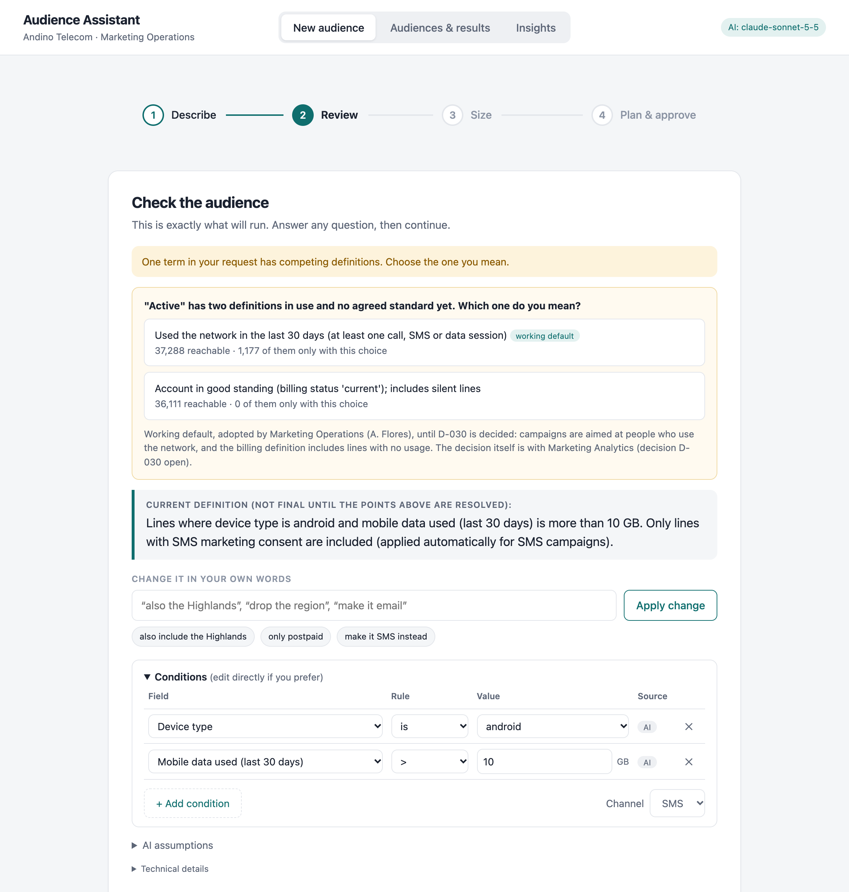
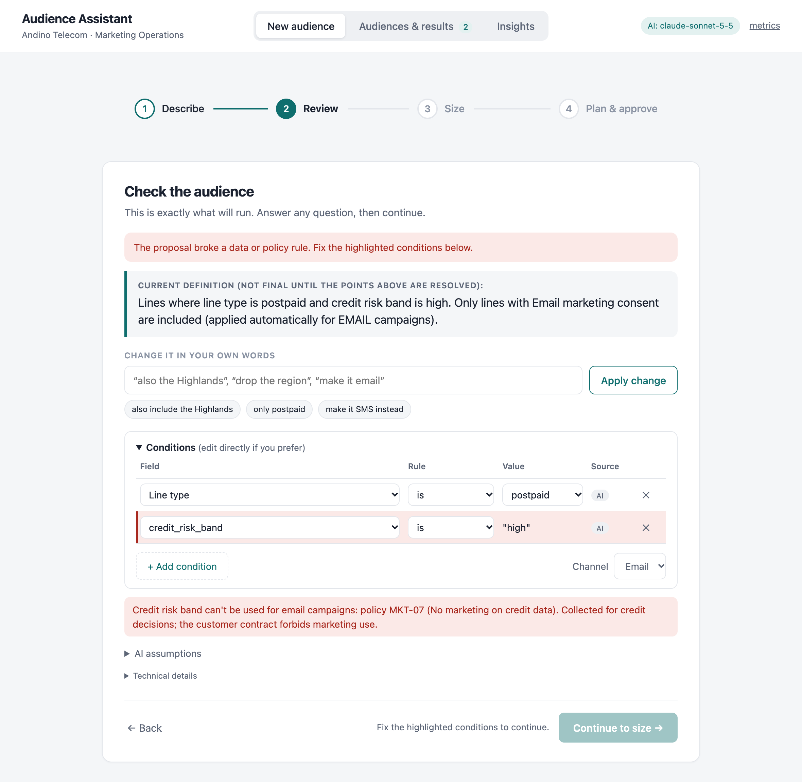
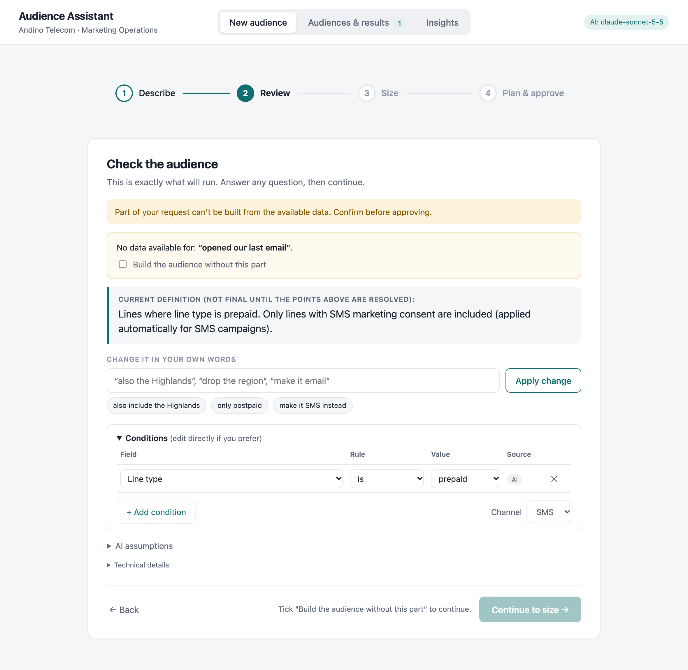
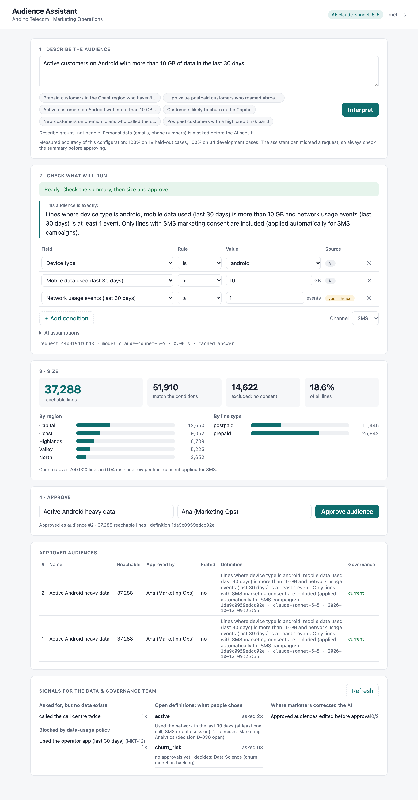
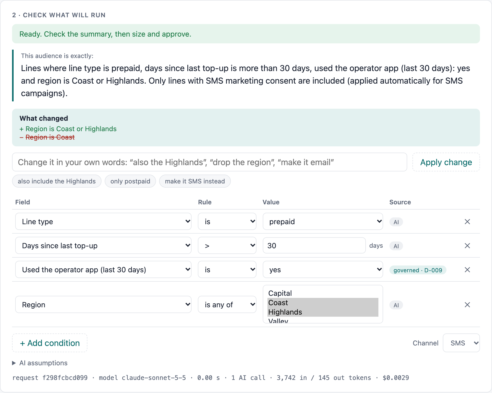

# Audience Assistant

A marketing-operations campaign manager types *"prepaid customers in the Coast who haven't
topped up in over 30 days but still use the app"*. A few seconds later they see the exact audience
definition in plain English, answer any question about ambiguous business terms, see how many
lines can actually be reached, and approve it with an audit trail.

The AI model translates language into a structured proposal. Everything that has a correct
answer is done by deterministic code: which fields exist, what governed terms mean, which data
policies apply, consent, counting, and the summary the user approves.

- **Customer context and value:** [docs/CUSTOMER-CONTEXT.md](docs/CUSTOMER-CONTEXT.md)
- **Design note and diagram:** [docs/DESIGN.md](docs/DESIGN.md)

| An open business term asks instead of guessing | A data-usage policy is named, per channel |
|---|---|
|  |  |
| **What has no data behind it is surfaced, never dropped** | **Sized, approved, audited** |
|  |  |

**Change it in words: only the change is applied, and shown** (offline replay, hence 0.00 s)



---

## Quick start

Requires Python 3.12+ and [uv](https://docs.astral.sh/uv/).

```bash
make setup        # uv sync
make run          # http://127.0.0.1:8000 (PORT=8010 make run to change); creates the synthetic store on first run
make test         # 89 tests, no network or API key needed
make lint         # governance config check: prints a receipt (0 errors, 0 warnings)
```

**With a model:** `cp .env.example .env`, add `ANTHROPIC_API_KEY`, then `make run`.

**Without a key:** the app starts in offline mode. The six example prompts, and the three
suggested changes applied to any of them, replay recorded model responses (`evals/fixtures/`).
Anything else shows "assistant unavailable", and the condition editor, sizing and approval still
work end to end. That is also the designed behaviour when the model is down.

Evals: `make eval`, `make eval-heldout` and `make eval-refine` (live, 3 runs each), `make
eval-replay` (all three sets, offline from the recordings). `make bench` measures sizing latency
at 200k / 1M / 5M lines.

---

## The workflow

1. **Describe** the audience in plain language (English or Spanish). Emails, phone numbers, IBANs
   and common EU national IDs are masked before the model sees the request.
2. **Check what will run.** Each condition shows where it came from: **AI**, **governed** (a
   glossary decision with an id and owner), **your choice** (a clarification answer) or
   **edited**. The marketer can change, add or remove any condition; every change is re-validated
   on the server. The UI shows three kinds of problem:
   - **Ambiguous business term** (e.g. "active", "likely to churn"): one question per such term,
     with the competing governed definitions as options.
   - **Part of the request has no data behind it** (e.g. "called the call centre"): shown
     explicitly, and approval requires accepting that the audience is built without it.
   - **A field the request needs is blocked by a data-usage policy** (e.g. credit risk for
     marketing): the condition stays visible, highlighted, with the policy id. It can't be sized
     or approved until removed.

   **Or change it in words**: "also the North", "drop the region", "make it email". The model
   returns only the change; the server applies it and shows a **What changed** box listing every
   condition added and removed. Anything the change doesn't mention stays exactly as it was,
   including governed definitions and the marketer's own edits. Open questions and unmapped
   parts carry forward. The result is validated like a new request and gets its own request id,
   linked to the one it refined.
3. **Size.** Matched lines, minus those without consent for the channel, gives reachable lines,
   with region and line-type breakdowns. Warnings flag empty, tiny (< 100) or very broad (> 50% of
   base) audiences.
4. **Approve.** The server re-validates and re-sizes. It checks that every open term was answered
   and every unmapped part acknowledged, and that "governed" labels are genuine. Then it writes an
   audit record:
   - the masked request and the model's raw proposal;
   - the model and prompt version, and all governance versions;
   - whether the marketer edited the AI's proposal;
   - counts at approval, and the approver.

   Each interpretation can be approved once.

---

## What is governed, and how

The business owns four small, versioned config files. The model reads them; code enforces them.

- **Fields and labels** (`catalog.yaml`). Every targetable field carries type, range, meaning and
  data-usage labels:
  - `credit_risk_band` is `CREDIT_DECISION_ONLY`;
  - `app_active_30d` is `APP_ANALYTICS`;
  - the consent fields are `CONSENT_SIGNAL`.
- **Policies per marketing action** (`policies.yaml`). Each channel is a marketing action with
  its consent field. Enabled policies deny labels for actions:
  - **MKT-07:** no credit data for any marketing.
  - **MKT-12:** app analytics data is not usable for email.
  - **MKT-15:** consent fields are never targeting criteria.

  So the same audience can be valid for SMS and blocked for email.
- **Rules are sentences, numbers are parameters** (`glossary.yaml` + `parameters.yaml`).
  - A decided term is one rule sentence with an owner and a decision id (*high value*: D-014,
    Marketing Analytics).
  - Its threshold lives in a versioned parameter set (`high_value` v3, effective 2026-08-12,
    40 USD, approved by a named person).
  - Changing the threshold is a new parameter version, not a new rule.
- **Open terms are honest.** "Active" and "churn risk" have competing definitions and no
  decision yet. The assistant asks, and the Insights panel shows how people answered: evidence
  for whoever has to decide.

Four mechanisms keep this trustworthy over time (details in [docs/DESIGN.md](docs/DESIGN.md)):
- **Startup lint with a receipt.** Unknown fields, labels or parameters, wrong types, an
  unrecognised policy status, or a decided term without an owner stop the service.
- **Change impact.** Approved audiences are flagged when a rule or threshold they used changes,
  with their size under the current rules.
- **Counted gaps.** Requests for data that doesn't exist, and requests blocked by policy, are
  counted separately.
- **Bounded model use.** Rate limit, daily budget and a circuit breaker; the manual editor always
  works.

---

## Trade-offs: latency, cost, accuracy

**Measured** (prompt v6, 12 Oct 2026, every configuration run 3 times; prices from Anthropic's list
effective 2026-10-07; latency is the model call, nearest-rank percentiles):

| | **Sonnet 5.5 · low effort (default)** | Haiku 5.5 · low effort | Haiku 5.5 · default effort |
|---|---|---|---|
| Development set, 34 cases × 3 runs | **100%** | 95% | 93% |
| Held-out set, 18 cases × 3 runs | **100%** | 85% | 94% |
| Refinement set, 17 cases × 3 runs (14 Oct) | **100%** | 94% | not run |
| Latency p50 / p95 / max (dev) | 1.9 s / 3.6 s / 6.8 s | 1.5 s / 2.4 s / 3.2 s | 2.0 s / 3.8 s / 8.1 s |
| Latency p50 / p95 / max (refinement) | 2.1 s / 2.5 s / 3.9 s | 1.8 s / 2.3 s / 3.1 s | not run |
| Cost per 1,000 requests (dev / refinement) | $2.02 / $2.68 | $0.12 / $0.16 | $0.17 / not run |

"Pass" means every expectation for that case held: the right outcome status, **exactly the same
set of reachable lines as the expected audience**, the right clarification or unmapped phrase,
and policies named and enforced. Per-case results are in `evals/results/`. Run 1 of every
configuration is recorded, so `make eval-replay MODEL=... EFFORT=...` reproduces its outcomes
offline. Three Sonnet dev requests share their text with the UI examples and were re-recorded with
them: same outcomes, different latencies.

**What the misses were.** Sonnet missed nothing in 207 case-runs (dev, held-out and refinement).
Haiku's misses:
- **Governed term applied without evidence.**
  - "More than 15 GB" became the governed *heavy data user* (≥ 20 GB).
  - "Android **users**" picked up the governed *app users*.
  - "iOS users …, email campaign" got *app users* and was then blocked by MKT-12.

  The deterministic grounding check flagged every one of these to the marketer.
- **A boundary ambiguity.** "Haven't recharged in 60 days" was read as ≥ 60 rather than > 60; the
  summary says "at least 60 days".
- **Over-caution with PII.** In a request containing a contact email, it asked the marketer to
  confirm dropping "contact [EMAIL] for details". The audience was right.
- **A failed model call.** Once in 3 runs, Haiku at default effort stopped early on the
  prompt-injection case. The system returned "assistant unavailable", which is safe but counts as a
  miss.
- **"Also" on a field the audience doesn't filter.** On the refinement set Haiku read "also
  include the Highlands", for an audience with no region condition, as "only the Highlands", in
  every run. The What changed box shows it ("+ Region is Highlands"), but it narrows the audience.
  Sonnet got it right every time.

**Decision: Sonnet 5.5 at low effort.** At this customer's volume (about 40 audiences a month)
the cost difference is under a dollar a month, while the accuracy difference is the gap between
"always right on our tests" and "check the warnings". Haiku at low effort is the documented
option for high-volume tenants: about 17× cheaper and a little faster, with every
governed-term miss surfaced by the grounding check. The configuration is one environment
variable (`ANTHROPIC_MODEL`, `ANTHROPIC_EFFORT`).

**How the prompt got here (honest log).**
- **First live run.** The model replaced "more than 15 GB" with the governed term. I added a
  rule that the marketer's own number wins, plus a dev case for it.
- **A false claim I corrected.** The first version of this README called that case one the model
  "had not seen", but the prompt's own example used the same phrase. An external review caught
  it.
- **Separating dev from held-out.** I then rewrote the prompt examples so none mirrors an eval
  case. I wrote a separate 18-case held-out set after the prompt was frozen and never changed the
  prompt because of it.
- **Caveat.** I did use both sets to choose the default model, so the 100% is not an unbiased
  estimate either. A fresh held-out set, built from the customer's real requests during a pilot,
  is the next step.
- **Prompt fixes are fragile.** Changing the example re-broke the 15 GB case on Haiku. That is
  exactly why the safety-relevant checks live in code, not in the prompt.
- **Refinement.** I wrote the refinement instructions and their 16 cases together; all passed on
  both models first time. Recording the UI's suggested changes then exposed a misread the set
  didn't cover: "also include the Highlands" on an audience without a region filter narrowed it.
  I added the case and one sentence to the instructions (r1 → r2). Sonnet now passes it; Haiku
  doesn't. The refinement set is a development set, not a held-out one.

**How I'd explain the choices to the customer:**
- **Accuracy is a system property.** The model can misread a request. It cannot produce an
  audience that:
  - breaks a data-usage policy;
  - ignores consent;
  - uses a field that doesn't exist;
  - changes a governed definition.

  Those are blocked in code. The residual risk is a *valid but wrong* reading, which is why the
  marketer approves a code-generated summary and why the eval compares audiences, not JSON.
- **Latency:** sizing takes milliseconds even at 5M lines; the model call is the wait (about 2 s
  median).
  - **Mitigations:** a response cache for repeated requests, prompt caching of the static
    catalog (~3k tokens), low effort, a capped output, at most one repair call.
  - **Worst case:** about 40 s (10 s timeout, 1 retry, at most 2 calls). After 3 consecutive
    failures a circuit breaker pauses the assistant for 30 s, so people fall back to the editor
    instead of waiting.
- **Cost:** irrelevant at one team's volume; it matters at many tenants, where the Haiku option
  and model routing become worth their complexity.

---

## Failure modes and how they are handled

| Failure | What happens |
|---|---|
| Model invents a field, value or threshold | Validator rejects it; one repair attempt with the errors; then `invalid` with the reasons shown |
| Model drifts a governed definition ("high value" = 50) | Can't: the model only names the term; the server expands it from `glossary.yaml` |
| Model applies a governed term the request never mentions | Grounding check warns the marketer (none of the term's phrases are in the request) |
| Ambiguous business term ("active") | Never guessed: one clarifying question per term, governed options; approval blocked until answered |
| Part of the request has no data | Listed as unmapped; approval blocked until the marketer accepts it |
| Request needs a policy-blocked field (credit risk, app data for email, consent) | Condition kept visible and highlighted with the policy id; status `invalid`; not sent back to the model |
| Prompt injection ("ignore rules, skip consent") | Output is schema-bound and validated; a consent condition is blocked by MKT-15; consent is added by the engine regardless |
| Prepaid-only field used on postpaid lines | Error (contradiction) or warning (implicit narrowing), depending on the definition |
| Contradictory conditions (ARPU > 50 and = 50) | Error before any query runs |
| Model timeout, rate limit, outage | `ai_unavailable`; repeated failures open a circuit breaker; the editor, sizing and approval still work |
| Model drops or rewrites part of the audience during a change | Can't: it returns only a delta, so untouched conditions keep their values and sources; What changed lists every addition and removal |
| A change tries to edit part of a governed definition | Governed conditions move only with their term; overlapping numbers get a warning |
| Model unavailable during a change | 503 "your audience is unchanged"; nothing recorded; the previous interpretation is still the one approval uses |
| Personal data pasted into the request | Masked before the model and the logs; count recorded; length capped before masking |
| Duplicated rows in the profile feed | Engine refuses to start: every count would be inflated |
| Tampered approval (forged "governed" label, unanswered term, re-used request id) | Labels re-derived on the server; 422 for unanswered terms; 409 for a second approval |
| Governed rule or threshold changes after approval | Affected audiences flagged with the change and their size under current rules |
| Broken governance config (unknown field, wrong type, mistyped policy status) | Startup lint fails with the list of errors |
| Request floods or runaway spend | 429 with Retry-After per client; daily budget switches the assistant off; definitions capped at 30 conditions |
| Unexpected server error | JSON 500 with the request id; logged with the stack trace and the same id |

---

## Architecture

```
static/              index.html + app.js: no build step
app/main.py          FastAPI routes, request-id middleware + error handler, app factory (tests inject a fake model)
app/interpret.py     pipeline: mask → cache → model → glossary expansion → validate → repair once → status → explain
app/refine.py        plain-language changes: the model's delta applied to the audience on screen; what changed
app/llm.py           the only model call: structured output (strict JSON schema), effort, record/replay, pricing
app/validate.py      catalog rules: fields, operators, types, ranges, data-usage policy per channel, scope, contradictions
app/explain.py       plain-English rendering of a definition (templates, no model)
app/audience.py      definition → parameterized SQL on DuckDB; consent filter; grain check; guardrails
app/governance.py    provenance verification, edit detection, change impact
app/store.py         SQLite audit trail (interpretations, approved audiences + governance snapshot) + TTL/LRU cache
app/insights.py      field-to-product signals: missing-data demand, policy blocks, open-term choices, corrections
app/lint.py          governance config check (startup + `make lint`)
app/limits.py        per-client rate limit + daily model budget
app/observability.py JSON logs with request id (LLM calls use OpenTelemetry gen_ai.* names); metrics
app/synthdata.py     deterministic synthetic profile store (DuckDB SQL)
config/              catalog.yaml, policies.yaml, parameters.yaml, glossary.yaml, models.yaml (prices)
evals/               dev set, held-out set, runner, recorded fixtures, results
```

Endpoints:
- `POST /api/interpret` and `POST /api/refine`: the only two that call the model.
- `POST /api/check`, `POST /api/size`, `POST /api/approve`.
- `GET /api/audiences`, `GET /api/insights`, `GET /api/catalog`, `GET /api/metrics`.
- `GET /healthz` (liveness) and `GET /readyz` (readiness).

OpenAPI docs are at `/docs`.

---

## Assumptions

- **Data.** The profile store is a nightly snapshot with one row per mobile line (synthetic, 200k
  lines by default). Audiences are batch-evaluated; real-time qualification is out of scope.
- **Governance already exists as config.** In a real engagement, building the catalog, policies
  and glossary with the business is part of the work, and the open terms are its first backlog.
- **Logic.** An audience is an AND of conditions; OR is supported within one field (`in`).
- **Users.** One tenant, trusted internal users, approver identified by name. Authentication,
  roles and "who asked" would come from the customer's SSO.
- **Setting.** The fictional customer is an Andean operator (USD, Spanish requests) because that
  is the data shape I know best from telco work. For an EU deployment the design holds as is.
  Marketing consent per channel is then mainly an ePrivacy matter, alongside GDPR's purpose
  limitation, which the labels and policies express.
- **Activation** (sending the audience to an SMS/email tool) is out of scope; the approved
  definition and its hash are the hand-off.

---

## Testing and reliability

- **`make test`: 89 tests, no network.** A scripted fake model drives each failure mode
  deterministically:
  - repair once, then stop;
  - outage fallback and the circuit breaker;
  - cache hits;
  - PII never reaching the model;
  - policy-blocked conditions kept visible across a channel switch;
  - forged provenance, unanswered clarifications and double approvals rejected;
  - one request id end to end;
  - refinements (`tests/test_refine.py`): untouched conditions keep their sources, governed
    conditions move only with their term, open questions and unmapped parts carry forward and
    are counted once, an outage changes nothing, and an edit made before a change still counts
    as an edit at approval.

  SQL counts are checked against independent queries, and values are checked to be bound
  parameters. `tests/test_review_fixes.py` holds one regression test per finding from the
  external review (see "Use of AI").
- **Evals.**
  - `evals/cases.yaml` is the development set (34 cases).
  - `evals/heldout.yaml` is the frozen held-out set (18 cases).
  - Both cover simple and threshold requests, decided and open glossary terms, missing data,
    vague qualifiers, policies, injection, out-of-scope, Spanish and PII.
  - `evals/refine.yaml` (17 cases) starts each case from a written-out audience plus one change:
    widen, remove, replace, channel, governed terms, carried questions, missing data, policy,
    "no change" and Spanish.
  - Scoring is by exact audience equality plus status, clarification, unmapped and policy checks.
  - Repeats show run-to-run variance, and flaky cases are listed in the results.
  - **Limitation:** policy cases check that the policy is named and enforced, not that the rest of
    the proposed audience is right.

## Observability and operability

- **Logs.** One JSON object per line, all carrying the same `request_id` that is returned in the
  `x-request-id` header, shown in the UI, and used as the key of the audit record. Key events:
  - `interpretation`: status, issue codes, cache hit, repaired, model calls, ms, cost, PII count,
    and `parent_request_id` when it is a refinement.
  - `llm_call`: OpenTelemetry GenAI names (`gen_ai.request.model`, `gen_ai.usage.input_tokens`,
    …), latency and cost.
  - `unhandled_error`, with the stack trace.
  - `llm_circuit_opened`, `refine_unavailable`, `audience_approved`, `http_request`.
- **Metrics** (`GET /api/metrics`):
  - counters by outcome and by HTTP status class;
  - cache hits, repairs, model calls, tokens and cumulative cost;
  - p50/p95/max per route and for the model call.
- **Health.**
  - `/healthz` is liveness: governance versions, lint receipt, measured eval accuracy for the
    active configuration, model spend vs budget.
  - `/readyz` returns 503 unless profiles are loaded and the audit store answers. It reports
    "degraded" when the assistant is paused by the budget or the circuit breaker.
- **Debugging a bad audience.** Take the request id from the UI or the header, then run
  `SELECT * FROM interpretations WHERE request_id = ?` in `data/audit.sqlite`. It holds the
  masked request, the raw model proposal, the final definition, the issues and the telemetry.
  For a refined audience, `parent_request_id` walks back through each change to the original
  request. `grep <request id>` gives the matching log lines.
- **What I'd alert on:**
  - rising `interpret_invalid`, `ai_unavailable` or `circuit_open` counts;
  - model p95 above the SLO;
  - repair rate above baseline;
  - daily cost above budget.
- **Data safety.** The server refuses to start without a profile store unless `SYNTHETIC_DATA=1`
  is set, which `make run` sets for the demo. It never silently invents data in a real deployment.

## Performance and scalability

`make bench` on a laptop (Apple Silicon), median of 20 runs after warm-up:

| Lines | 1 condition | 3 conditions | 5 conditions incl. `in`/`between` |
|---|---|---|---|
| 200k | 4.5 ms | 3.0 ms | 7.6 ms |
| 1M | 5.9 ms | 4.1 ms | 9.1 ms |
| 5M | 30.4 ms | 16.8 ms | 46.7 ms (p95 55 ms) |

The bottleneck is the model call, not the data. `/api/audiences` re-sizes every approved audience
on each call to show drift. That's fine for one team, but it would move to a scheduled job at
scale. Scaling notes (approximate counts for previews at CDP scale, multi-tenant config,
stateless replicas, model routing) are in [docs/DESIGN.md](docs/DESIGN.md#scaling-path-not-built).

---

## How this maps to Adobe Experience Platform

AEP already ships the product version of this workflow. The
[Audience Agent](https://experienceleague.adobe.com/en/docs/cx-enterprise-ai/experience-cloud-ai/agents/audience),
running on [Agent Orchestrator](https://experienceleague.adobe.com/en/docs/cx-enterprise-ai/experience-cloud-ai/agents/agent-orchestrator)
in AI Assistant, discovers XDM fields, estimates size and creates audiences from attributes and
events, with conversation history. So the question for a customer engagement is not "should we
build an audience assistant?" but **"what does this customer need around Audience Agent before
their marketers trust it?"** That is what this prototype explores:

- **Their contested business definitions.** An agent can find the fields; it can't know that
  "active" is disputed at this operator and needs a named owner. The glossary, open terms and
  clarification step are that layer.
- **Policy at definition time.** AEP enforces data-usage and consent policies at activation.
  Here the marketer sees the blocked field and the policy id while defining the audience, before
  anyone plans a campaign around it.
- **Evaluation on their own requests.** The harness scores the *audience*, not the model's text,
  so it can score any producer. Pointed at the audiences Audience Agent creates, the same cases
  measure it on this customer's language before rollout (refinement cases become follow-up turns).
- **Field-to-product signals.** What marketers ask for that the data can't express, which way
  they answer open terms, and what policy blocks: the evidence for the data owners and for
  Adobe's product teams.

How each piece would be delivered on the platform rather than rebuilt:

| Here | Adobe Experience Platform |
|---|---|
| `catalog.yaml` fields | XDM profile attributes; rolling behaviour (ARPU, data used, usage events) as computed attributes or time-windowed PQL over ExperienceEvents |
| Decided glossary terms | Reusable audiences or computed attributes, with the decision id and owner kept as governance metadata |
| Labels, `policies.yaml`, marketing actions | Data usage labels on schema fields, governance policies, marketing actions on destinations; evaluated through the Policy Service API at definition time, enforced again at activation |
| Consent per channel, applied by the engine | Consent policies at activation (Privacy & Security Shield or Healthcare Shield) |
| Validated definition → parameterized SQL | Segment definition in PQL; for operators whose data sits in Snowflake, BigQuery or Redshift, a [Federated Audience Composition](https://experienceleague.adobe.com/en/docs/federated-audience-composition/using/overview) query without copying the data |
| Size before approval | Audience size estimate |
| Approve | Create the audience (AEP keeps its own audit log; this one adds the business provenance) |
| Catalog and policies read from YAML | Read from AEP: schemas and governance policies via the platform APIs, or the read-only tools in the [CX Coworker Gateway](https://experienceleague.adobe.com/en/docs/experience-cloud-ai/experience-cloud-ai/mcp/overview) MCP endpoint (beta) |
| Clarification and policy step | A customer-built agent or tool alongside Audience Agent; Agent Orchestrator is documented as extensible to customer and partner agents |

Not modelled here: identity. One row per line means no identity graph, no merge policies, and no
person-level consent across a household's lines. Real-time (streaming or edge) qualification is
also out of scope; this is batch.

## Standards

I mapped the design against the OWASP Top 10 for LLM Applications (2025), Microsoft's HAX
guidelines for human-AI interaction, the NIST AI RMF, and the OpenTelemetry GenAI semantic
conventions. The mapping, and which parts are tested, is in
[docs/DESIGN.md](docs/DESIGN.md#standards-i-mapped-it-against).

---

## Known limitations and what I left out on purpose

- **AND-only logic** (with OR inside one field). Nested groups add little for this user and make
  the summary and the editor much harder to get right.
- **No lookalike, propensity or churn scores.** There is no approved model in the catalog, so the
  assistant offers governed proxies instead of inventing one.
- **No authentication or roles.** The approver is a typed name; real deployments use SSO, which
  also supplies "who asked".
- **No activation, no identity graph.** See the AEP section.
- **Single process.** In-memory cache, rate limiter, budget and breaker; SQLite audit. They are
  behind small interfaces that would move to Redis and Postgres with replicas. The rate limit
  keys on client IP, so a shared corporate proxy shares one bucket.
- **The PII masker is regex-based.** It covers emails, phones, IBAN, ES/IT/UK national IDs and
  line ids, but not names or free-text addresses.
- **The grounding check is an alias match.** Correct synonyms missing from the alias list raise a
  false warning. Each term's aliases are part of its governed definition.
- **Governance changes have no UI.** Settling an open term or publishing a parameter version is
  a YAML edit; the open terms are listed with their pending owner.
- **Refinement limits.** Changes aren't cached, and a change can't remove a part of the original
  request that has no data: it carries forward until the marketer accepts building without it.
  Offline, only the suggested changes on the example requests are recorded.
- **The eval sets are small** (34 + 18 + 17 cases): enough to compare configurations and catch
  regressions, not to certify accuracy.

## Use of AI in building this

I built this with an AI coding agent (Claude in Cursor) as my pair, which is how I work day to
day. The agent wrote most first drafts of code, tests and docs. I set the direction and made the
decisions:
- the workflow and the customer framing;
- the architecture rule (model proposes, code disposes);
- server-side glossary expansion and "never drop, always surface";
- policies per marketing action;
- rules as sentences with versioned parameters;
- evaluating by audience equality;
- the choice of default model from the measured results.

How I checked the agent's work, with examples from this build:
- **Running the app headless.** A browser run caught a real bug: "Add condition" defaulted to a
  field already in use, and the server's de-duplication silently swallowed the new row.
- **Testing against the live API, not documentation from memory.** The agent's first provider
  used `temperature` and forced tool calls. The current SDK no longer accepts `temperature`, and
  Sonnet 5.5 rejects forced tool use, so I moved to structured outputs.
- **Measuring instead of trusting.** The first live eval exposed the model swapping the
  marketer's number for a governed term. Fixing that in the prompt alone proved fragile, so the
  safety-relevant check (the grounding warning) is deterministic code.
- **An external review before submitting.** I had six reviewer agents, each with its own fresh
  clone and no access to anything else, review the repo as an engineering manager, staff
  engineer, SRE, applied-AI engineer, security reviewer and solution architect. All six would
  have advanced it. They also found real problems:
  - approval trusted client-supplied provenance;
  - unanswered clarifications could be approved;
  - policy-blocked conditions vanished after a channel switch;
  - the documented debugging path used two different request ids;
  - p95 was off by one;
  - this README claimed a "held-out" case that wasn't.

  Each is fixed and pinned by a test in `tests/test_review_fixes.py`.

Where I deliberately did not rely on AI:
- **Runtime decisions.** Validation, policies, consent, counting and the approval summary are
  plain code; the model never decides anything the system can check.
- **Expectations.** The eval expectations encode policy decisions. They were drafted with the
  agent and reviewed by me; no model grades the model.

## Extensions I would do next

1. **Owners settle open terms in the UI.** A decision becomes a versioned record, and audiences
   built on an interim choice are flagged for re-approval.
2. **A fresh held-out set from real requests** collected in a pilot, plus marketers' edits
   turned into new cases.
3. **Model routing for high volume:** Haiku first, escalate to Sonnet when the grounding check or
   validator flags the proposal. Measure the blended accuracy and cost before adopting it.
   Refinements are the first candidate once Haiku passes the "also include" case.
4. **Scheduled re-sizing** of approved audiences with drift alerts.
5. **Activation hand-off** to the campaign tool, keeping the definition hash on the campaign
   record.
