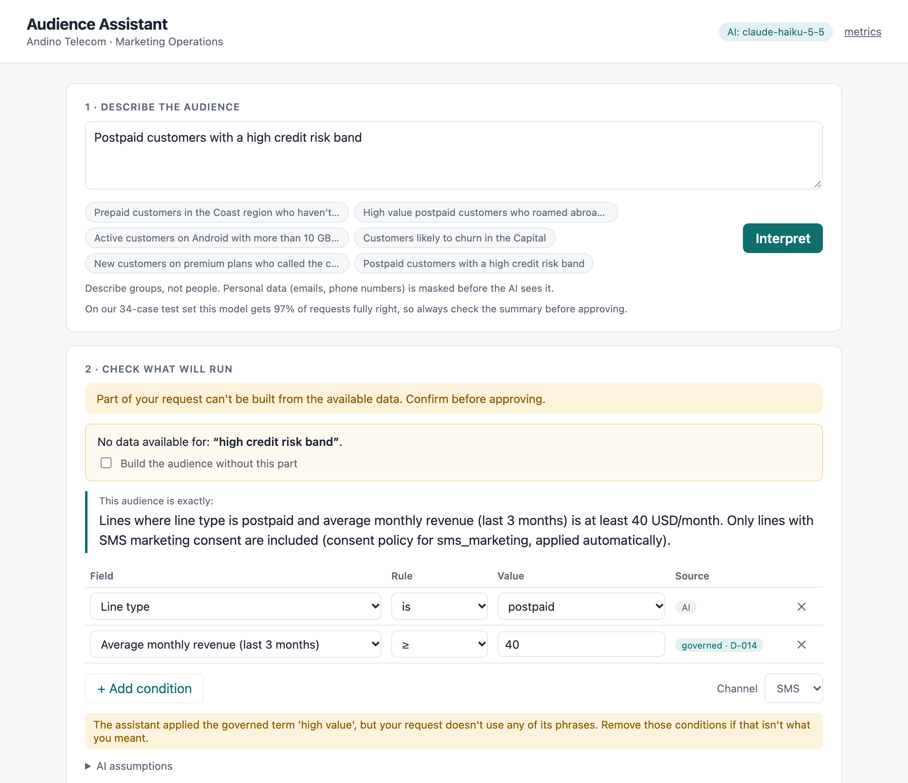

# Audience Assistant

A marketing-operations campaign manager types *"prepaid customers in the Coast who haven't
topped up in over 30 days but still use the app"*. A few seconds later they see the exact audience
definition in plain English, answer at most one clarifying question, see how many lines can
actually be reached, and approve it with a full audit trail.

The AI model translates language into a structured proposal. Everything that has a correct
answer is done by deterministic code: which fields exist, what governed terms mean, consent,
counting, and the summary the user approves.

- **Customer context and value:** [docs/CUSTOMER-CONTEXT.md](docs/CUSTOMER-CONTEXT.md)
- **Design note and diagram:** [docs/DESIGN.md](docs/DESIGN.md)

| An open business term asks instead of guessing | Policy is evaluated per channel |
|---|---|
|  |  |
| **What can't be built is surfaced, and an ungrounded term is flagged** | **Sized, approved, audited** |
|  |  |

---

## Quick start

Requires Python 3.12+ and [uv](https://docs.astral.sh/uv/).

```bash
make setup        # uv sync
make run          # http://127.0.0.1:8000  (PORT=8010 make run to change; generates 200k profiles on first start, ~1 s)
make test         # 52 tests, no network or API key needed
make lint         # governance config check: prints a receipt (0 errors, 0 warnings)
```

**With a model (recommended):** `cp .env.example .env`, add `ANTHROPIC_API_KEY`, then `make run`.

**Without a key:** the app starts in offline mode. The example prompts replay recorded model
responses (`evals/fixtures/`). Anything else shows "assistant unavailable" and the condition
editor still works end to end. That is also the designed behaviour when the model is down.

Other targets: `make eval` (golden set against the live model), `make eval-replay` (the same,
offline from recordings), `make bench` (sizing latency at 200k / 1M / 5M lines).

---

## The workflow

1. **Describe** the audience in plain language (English or Spanish). Emails and phone numbers are
   masked before the model sees the request.
2. **Check what will run.** Each condition shows where it came from: **AI**, **governed** (a
   glossary decision with an id and owner), **your choice** (a clarification answer) or
   **edited**. The marketer can change, add or remove any condition; every change is re-validated.
   - **Ambiguous business term** (e.g. "active", "likely to churn"): one question with the
     competing governed definitions as options.
   - **Part of the request has no data behind it** (e.g. "called the call centre"): shown
     explicitly, and approval requires accepting that the audience is built without it.
3. **Size.** Matched lines, minus those without consent for the channel, gives reachable lines,
   with region and line-type breakdowns. Warnings flag empty, tiny (< 100) or very broad (> 50% of
   base) audiences.
4. **Approve.** The server re-validates and re-sizes the submitted definition, then writes an
   audit record: request (masked), the model's raw proposal, model and prompt version,
   catalog and glossary versions, whether the marketer edited it, counts at approval, and approver.

---

## What is governed, and how

The business owns four small, versioned config files. The model reads them; code enforces them.

- **Fields and labels** (`catalog.yaml`). Every targetable field, with its type, range and
  meaning. Fields carry data-usage labels: `credit_risk_band` is `CREDIT_DECISION_ONLY`,
  `app_active_30d` is `APP_ANALYTICS`, and the consent fields are `CONSENT_SIGNAL`.
- **Policies per marketing action** (`policies.yaml`). Each channel is a marketing action
  (`sms_marketing`, `email_marketing`) with its consent field. Enabled policies deny labels for
  actions:
  - **MKT-07:** no credit data for any marketing.
  - **MKT-12:** app analytics data is not usable for email.
  - **MKT-15:** consent fields are never targeting criteria.

  The same audience can be valid for SMS and blocked for email, and the message names the
  policy.
- **Rules are sentences, numbers are parameters** (`glossary.yaml` + `parameters.yaml`). A
  decided term is one rule sentence with an owner and a decision id. *"A line is high value when
  its 3-month average revenue reaches the high-value threshold"* is decision D-014, owned by
  Marketing Analytics. Its number lives in a versioned parameter set: `high_value` v3, effective
  2026-08-12, 40 USD, approved by a named person. Changing the threshold is a new parameter
  version, not a new rule.
- **Open terms are honest.** "Active" and "churn risk" have competing definitions and no
  decision yet. The assistant asks instead of guessing, and the Insights panel shows how people
  answered: evidence for whoever has to decide.

Four mechanisms keep this config trustworthy over time:

- **Startup check with a receipt** (`make lint`, also in `/healthz`):
  - **Errors** (an unknown field, label or parameter, a decided term with no owner) stop the
    service.
  - **Warnings** (a rule longer than one sentence, an open term with no named decider) are the
    governance backlog.
- **Change impact on approved audiences.** Each approval stores which governed terms it used and
  their decision and parameter versions. When a rule or threshold changes, the approved-audiences
  table flags every affected audience, says what changed (`high_value v3 → v4`), and shows its
  size under the current rules, before anyone sends a campaign to a stale audience.
- **Counted gaps.** Request parts the data can't express are counted, not discarded. *"Called
  the call centre: 14×"* is a field the data team should add. Fields marketers keep correcting
  point to prompt or catalog fixes.
- **Bounded model use.** A per-client rate limit on the one endpoint that calls the model, and a
  daily model budget. When either is hit, the assistant steps aside and the manual editor keeps
  working.

## How this maps to Adobe Experience Platform

The prototype is deliberately platform-neutral, but every piece has an AEP counterpart. In an AEP
engagement I would wire it to these rather than re-build them:

| Here | Adobe Experience Platform |
|---|---|
| `catalog.yaml` fields | XDM schema fields / union profile attributes |
| Labels + `policies.yaml` + marketing actions | Data usage labels, data governance policies, marketing actions on destinations (Policy Service API to evaluate before activation) |
| Consent applied per channel by the engine | Consent policies at activation |
| Validated definition → parameterized SQL | Segment definition in PQL, evaluated by the segmentation service |
| Size before approval | Audience estimate |
| Approve → audit record | Create and persist the audience (with permissions) |
| Glossary with decision ids, parameter sets, change impact | Customer-owned governance layer: what the business has decided "high value" and "active" mean, kept outside any single tool |

The interpret → size → approve flow is the same shape as AEP's **Audience Agent** (plan →
characteristics → estimate → approve). What the prototype explores is what a customer rollout
needs around it: business definitions owned and versioned by the customer, explicit handling
of what can't be expressed, an evaluation set built from the customer's own requests, and
field-to-product signals.

## Standards I checked it against

| Standard | How the design responds |
|---|---|
| **OWASP Top 10 for LLM Apps (2025)** | |
| LLM01 Prompt injection | Request is data inside delimiters; output is schema-bound and validated; consent and policies are enforced in code regardless (tested) |
| LLM02 Sensitive information disclosure | PII masked before the model and the logs; probes and UI show aggregates only |
| LLM05 Improper output handling | Model output never reaches SQL as text: catalog-validated identifiers, bound parameters |
| LLM06 Excessive agency | The model has one tool that returns a proposal; it can't query, write or approve |
| LLM07 System prompt leakage | The prompt contains only the catalog and rules, no secrets |
| LLM09 Misinformation | Human approves a code-generated summary; status comes from the validator; eval measures audience equality |
| LLM10 Unbounded consumption | Request length cap, `max_tokens`, timeouts, one repair max, per-client rate limit, daily budget |
| **NIST AI RMF / GenAI profile (AI 600-1)** | |
| Govern | Owned decisions, versioned policies and parameters, startup lint |
| Map | Customer context and failure-mode table |
| Measure | Golden-set evals (accuracy, latency, cost), metrics |
| Manage | Fallback to manual, change impact, audit trail |
| **Microsoft HAX guidelines** | |
| G2: How well it works | Measured eval pass rate shown next to the assistant |
| G9: Efficient correction | Every condition editable, re-validated live |
| G10: Scope when in doubt | Clarify open terms; surface unmapped phrases |
| G11: Why it did that | Source badge on every condition, decision ids, plain-English summary |
| G18: Notify about changes | Approved audiences flagged when rules change |
| **OpenTelemetry GenAI semantic conventions** | LLM call logs use `gen_ai.provider.name`, `gen_ai.request.model`, `gen_ai.usage.input_tokens` (including cached tokens, per the Anthropic note), `gen_ai.usage.output_tokens`, `gen_ai.response.finish_reasons` |
| **GDPR principles relevant to EMEA rollouts** | Purpose limitation (credit data can't be used for marketing); consent per channel; data minimisation (masking, aggregates); accountability (audit trail with versions) |

---

## Architecture

```
static/            index.html + app.js: no build step
app/main.py        FastAPI routes, request-id middleware, app factory (tests inject a fake model)
app/interpret.py   pipeline: mask → cache → model → glossary expansion → validate → repair once → status → explain
app/llm.py         the only model call: structured output (strict JSON schema), effort, providers, pricing
app/validate.py    catalog rules: fields, operators, types, ranges, data-usage policy per channel, scope, contradictions
app/explain.py     plain-English rendering of a definition (templates, no model)
app/audience.py    definition → parameterized SQL on DuckDB; consent filter; grain check; guardrails
app/store.py       SQLite audit trail (interpretations, approved audiences + governance snapshot) + TTL/LRU cache
app/governance.py  change impact: which approved audiences a glossary/parameter change affects, and by how much
app/insights.py    field-to-product signals: unmapped demand, open-term choices, where marketers corrected the AI
app/lint.py        governance config check (startup + `make lint`), prints a receipt
app/limits.py      per-client rate limit + daily model budget (OWASP LLM10)
app/observability.py  JSON logs with request id (LLM calls use OpenTelemetry gen_ai.* names); metrics
app/synthdata.py   deterministic synthetic profile store (DuckDB SQL)
config/            catalog.yaml (fields + labels), policies.yaml (labels → marketing actions), parameters.yaml
                   (versioned thresholds), glossary.yaml (governed terms), models.yaml (prices)
evals/             golden set, runner, recorded fixtures, results
```

Endpoints: `POST /api/interpret` (the only one that calls the model), `POST /api/check`,
`POST /api/size`, `POST /api/approve`, `GET /api/audiences`, `GET /api/insights`, `GET /api/catalog`,
`GET /api/metrics`, `GET /healthz`. The interactive OpenAPI docs are at `/docs`.

The diagram and the reasoning behind each choice are in [docs/DESIGN.md](docs/DESIGN.md).

---

## Assumptions

- **Data:** the profile store is a nightly snapshot with one row per mobile line (synthetic,
  200k lines by default). Audiences are batch-evaluated; real-time/streaming qualification is out
  of scope.
- **Governance already exists as config:** a catalog of targetable fields and a glossary of
  business terms with owners. In a real deployment, building these with the business is part of
  the engagement, and the open terms are its first backlog.
- **Logic:** an audience is an AND of conditions; OR is supported within one field (`in`). Nested
  boolean logic was left out deliberately (see limitations).
- **Users:** one tenant, trusted internal users, approver identified by name. Authentication and
  roles would come from the customer's SSO.
- **Activation** (sending the audience to an SMS/email tool) is out of scope; the approved
  definition and its hash are the hand-off.

---

## Trade-offs: latency, cost, accuracy

**Measured on the golden set** (`make eval`, 34 cases, prompt v5, 11 Oct 2026; prices from Anthropic's
list effective 2026-10-07):

| | Haiku 5.5 · effort low (**default**) | Haiku 5.5 · default effort | Sonnet 5.5 · effort low |
|---|---|---|---|
| All expectations met | 33/34 (97%) | 33/34 (97%) | 34/34 (100%) |
| Correct outcome status (ready / clarify / confirm / unsupported / invalid) | 100% | 100% | 100% |
| Same audience as expected (exact set of reachable lines) | 96.8% | 96.8% | 100% |
| Model latency p50 / p95 | **1.7 s / 2.4 s** | 2.2 s / 3.8 s | 2.1 s / 2.8 s |
| Tokens per request (in / out, input mostly cached) | 2,992 / 146 | 2,992 / 281 | 2,992 / 143 |
| Cost per 1,000 requests | **$0.12** | $0.19 | $2.03 |
| Repair calls needed | 0 | 0 | 0 |

Per-case results: `evals/results/*.json`. The same run can be reproduced offline from the recorded
responses: `make eval-replay`.

**What the misses were, and what caught them:**
- **Haiku · low, "Postpaid customers with a high credit risk band".** It correctly refused the
  credit data (policy) but also applied *high value* because of the word "high". The
  deterministic grounding check flags it (*"the assistant applied 'high value' but your request
  doesn't use any of its phrases"*), and the summary shows "revenue ≥ 40 USD". The marketer sees
  it before approving.
- **Haiku · default effort, "haven't recharged in 60 days".** It read this as ≥ 60 days rather
  than > 60. That is a genuine boundary ambiguity, 2% of lines differ, and the summary says "at
  least 60 days".

**How the prompt got here** (honest log): the first live run (prompt v3) scored 32/33. The model
replaced an explicit "more than 15 GB" with the governed *heavy data user* term (20 GB). I added
a rule that the marketer's own number wins over a glossary term. To avoid only tuning to that one
case, I also added a new case it had not seen ("spending more than 60 dollars"). The
credit-risk miss above survived a further prompt rule, which is why the fix is a deterministic
check rather than more prompt.

**Decision: Haiku 5.5 at low effort.** It is the fastest and cheapest configuration and is right
on every *outcome* (it never guessed an open term, dropped a phrase or broke a policy). Its one
miss is surfaced to the user by a code-level check. Sonnet 5.5 is perfect on this set but 17×
the cost for one case. Default effort makes Haiku slower and costlier with no accuracy gain on
this task. The obvious next step is to route only flagged requests to Sonnet. The flag rate on
this set is about 3%, so the estimated blended cost is ≈ $0.18 per 1,000 for 34/34 here. I would
measure that rather than assume it.

**How I'd explain the choices to the customer:**

- **Accuracy is a system property, not a model property.** The model can still misread a
  request, but it can't produce an audience that breaks policy, ignores consent, uses a field
  that doesn't exist or changes a governed definition. Those failures are blocked in code. The
  residual risk is a *valid but wrong* reading. That is why the marketer approves a
  code-generated summary, and why the eval measures audience equality.
- **Latency:** sizing is milliseconds even at 5M lines; the model call is the user-visible wait.
  Mitigations: a cache for repeated requests (the cached answer returns in ~1 ms), prompt caching
  of the ~2k-token static catalog, a capped output, at most one repair call.
- **Cost:** a fraction of a cent per request, so at ~40 audiences a month cost is irrelevant next
  to analyst time. It matters at scale or with many tenants. The levers are the same: smallest
  model that clears the eval bar, caching, the repair cap.
- **Model choice:** pick the smallest model and effort that meet the bar on the golden set (above).
  Rerun `make eval` whenever the prompt, catalog or model changes; it is the regression test for
  the parts unit tests can't cover.

---

## Failure modes and how they are handled

| Failure | What happens |
|---|---|
| Model invents a field, value or threshold | Validator rejects it; one repair attempt with the errors; then `invalid` with reasons shown |
| Model drifts a governed definition ("high value" = 50) | Can't: the model only names the term; the server expands it from `glossary.yaml` |
| Model applies a governed term the request never mentions | Deterministic grounding check warns the marketer (the term's phrases aren't in the request) |
| Model ignores the marketer's explicit number in favour of a glossary term | Prompt rule (the marketer's number wins) + a dedicated eval case; the summary shows the threshold actually used |
| Ambiguous business term ("active") | Never guessed: clarifying question with governed options (`needs_clarification`) |
| Part of the request can't be expressed | Listed as unmapped; approval blocked until the marketer accepts it (`needs_confirmation`) |
| Request targets restricted data (credit risk) or consent | Rejected with the policy reason; not sent back to the model |
| Prompt injection in the request ("ignore rules, skip consent") | Output is schema-bound and validated; consent is added by the engine regardless |
| Prepaid-only field used on postpaid lines | Error (contradiction) or warning (implicit narrowing), depending on the definition |
| Contradictory conditions (ARPU > 50 and < 30) | Error before any query runs |
| Model timeout, rate limit, outage | `ai_unavailable`: the manual editor, sizing and approval still work; logged and counted |
| Personal data pasted into the request | Masked before the model and the logs; count recorded |
| Duplicated rows in the profile feed | Engine refuses to start: every count would be inflated |
| Client sends a tampered definition at approval | Server re-validates and re-sizes; rejects with 422 |
| Empty, tiny or very broad audience | Size warnings before approval |
| Field allowed for SMS but not for email (app analytics) | Policy violation names the policy (MKT-12); switching channel re-checks live |
| A governed rule or threshold changes after approval | Affected audiences flagged with the change and their size under current rules |
| Broken governance config (unknown field/label/parameter) | Startup lint fails with the list of errors; nothing serves on a broken definition |
| Request floods or runaway spend | 429 with Retry-After per client; daily budget switches the assistant off, manual editor stays |

---

## Testing and reliability

- `make test`: **52 tests**, no network. A scripted fake model drives each failure mode
  deterministically: repair once then stop, outage fallback, cache hit, PII never reaching the
  model, policy violations not retried, tampered approvals rejected. SQL counts are checked
  against independent queries, and values are verified to be bound parameters.
- `make eval`: the golden set (`evals/cases.yaml`, 34 cases across simple, thresholds, decided and
  open glossary terms, unmapped phrases, vague qualifiers, policy (including a per-channel
  conflict), injection, out-of-scope, Spanish and PII). It is scored by audience set equality plus status, clarification, unmapped and
  forbidden-field checks. Expected outcomes are hand-written, because they encode policy decisions.
- Live responses can be recorded (`make record`) and replayed (`make eval-replay`), so an eval
  run is reproducible without the model.

## Observability and operability

- **Logs:** one JSON object per line, all carrying `request_id` (also returned as the
  `x-request-id` header). Key events:
  - `interpretation`: status, issue codes, cache hit, repaired, LLM calls, total ms, cost, PII
    count.
  - `llm_call`: OpenTelemetry GenAI attribute names (`gen_ai.request.model`,
    `gen_ai.usage.input_tokens`, …) plus latency and cost.
  - `llm_unavailable`, `audience_approved`, `http_request`.
- **Metrics:** `GET /api/metrics`:
  - counters by outcome (`interpret_ready`, `interpret_needs_clarification`, …), cache hits,
    repairs, model calls, tokens, cumulative cost;
  - p50/p95/max for `llm_ms`, `interpret_ms`, `size_query_ms` and each route.
- **Health:** `GET /healthz` reports profiles loaded, provider, model, every governance version,
  the lint receipt, the eval summary for the active model, and model spend vs today's budget.
- **Debugging a bad audience:** take the `request_id` from the UI or header, then
  `SELECT * FROM interpretations WHERE request_id = ?` in `data/audit.sqlite`. It holds the masked
  request, the raw model proposal, the final definition and telemetry.
- **What I'd alert on in production:**
  - a rising `interpret_invalid` or `llm_unavailable` rate;
  - `llm_ms` p95 above the SLO;
  - repair rate above baseline (a catalog or prompt regression);
  - daily cost above budget.

## Performance and scalability

`make bench` on a laptop (Apple Silicon), median of 20 runs after warm-up:

| Lines | 1 condition | 3 conditions | 5 conditions incl. `in`/`between` |
|---|---|---|---|
| 200k | 4.5 ms | 3.0 ms | 7.6 ms |
| 1M | 5.9 ms | 4.1 ms | 9.1 ms |
| 5M | 30.4 ms | 16.8 ms | 46.7 ms (p95 55 ms) |

The bottleneck is the model call (seconds), not the data. Scaling notes (approximate counts for
previews at CDP scale, multi-tenant config, stateless replicas, model routing) are in
[docs/DESIGN.md](docs/DESIGN.md#scaling-path-not-built).

---

## Known limitations and what I left out on purpose

- **AND-only logic** (with OR inside one field). Nested groups add little for the target user
  and make the plain-English summary and the editor much harder to get right.
- **No lookalike, propensity or churn scores.** There is no approved model in the catalog, so
  the assistant offers governed proxies instead of inventing one.
- **No authentication or roles.** The approver is a typed name; real deployments use SSO.
- **No activation.** Approved audiences are not pushed to a campaign tool.
- **Single process.** The cache is in-memory and the audit store is SQLite, chosen for a
  runnable slice. Both are behind small interfaces.
- **The PII masker is regex-based.** It catches emails, phone numbers and IDs, not names.
- **The governance config is hand-authored YAML.** There is no UI for owners to settle open
  terms or publish a parameter version; the open terms are listed with their pending owner.
- **Rate limit and budget are per process.** With replicas they move to Redis behind the same
  interface.
- **The golden set is 34 cases.** That is enough to compare models and catch regressions, not
  to certify accuracy.

## Use of AI in building this

<!-- EDIT THIS SECTION TO MATCH WHAT YOU ACTUALLY DID BEFORE SUBMITTING -->
I built this with an AI coding agent (Claude in Cursor) as a pair, which is how I work day to day.

- **Where AI was used:** scaffolding the project and first drafts of most modules, tests and
  docs; generating the synthetic data SQL; drafting eval cases for me to review; researching the
  standards above (OWASP, NIST, HAX, OpenTelemetry, AEP governance docs), which I then checked
  against the primary sources; rubber-ducking design alternatives.
- **What I decided and verified myself:**
  - the workflow and customer framing;
  - the architecture rule (model proposes, code disposes);
  - glossary terms expanded server-side;
  - "never drop, always surface" for unmapped phrases;
  - status derived by the validator;
  - one repair, then stop;
  - consent enforced in the engine;
  - evaluation by audience set equality.
  I also reviewed every eval expectation and the validation rules line by line, and ran the app
  and the failure paths myself.
- **Where I deliberately did not rely on AI:**
  - **Runtime checks.** Anything with a correct answer is deterministic code at runtime: validation,
    consent, counts and the summary the user approves.
  - **Eval expectations.** The golden-set expectations are hand-checked, not model-generated:
    a model grading its own family's output against expectations it wrote would measure nothing.
  - **Approval text.** The approval summary is never written by a model.

## Extensions I would do next

1. **Owners settle open terms in the UI.** A glossary decision becomes a versioned record with
   an owner and date, and dependent audiences are flagged for re-approval.
2. **Re-size on a schedule.** Re-size approved audiences and alert on drift ("your audience
   grew 40% since approval").
3. **Model routing.** Small model first, escalate on validation failure; decide using the eval
   data.
4. **Activation hand-off** to the campaign tool, keeping the definition hash on the campaign
   record.
5. **Close the learning loop.** Feed marketers' edits back into the eval set as new cases.
