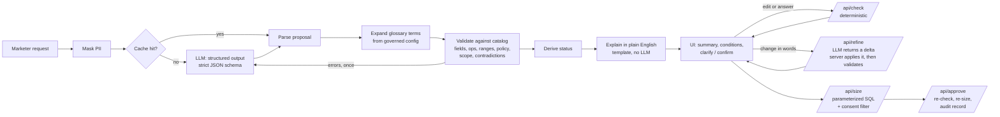

# Design note

## The one rule: the model proposes, deterministic code disposes

The model is good at one thing here: reading loose, sometimes Spanish, sometimes sloppy
language and mapping it to known fields. It is not trusted with anything that has a correct
answer: which fields exist, what "high value" means, whether consent applies, how many people
match, or what the summary says.

## Decisions and why

**1. The model fills a JSON schema; it never writes SQL.**
Structured output constrained to a strict JSON schema (`output_config.format`, every object
`additionalProperties: false`) means the response always parses into
`{conditions, glossary_terms, unmapped_phrases, channel, out_of_scope, assumptions}`. Column
names reach SQL only after validation against the catalog, and values are always bound
parameters. *Rejected: text-to-SQL.* It is more flexible, but every failure mode (wrong join,
missing consent, injection) becomes a SQL review problem the marketer cannot do.

**2. Glossary terms are named by the model and expanded by the server.**
For "high value customers" the model returns `glossary_terms: ["high_value"]`, not
`arpu_3m >= 40`. The server inserts the governed condition from `glossary.yaml`, so when the term
is named its threshold can't drift, and changing the definition is a config change with an owner
and a decision id, not a prompt change. Open terms ("active", "churn risk") become a clarifying
question with the competing definitions as options.

What this does not cover on its own is a model that ignores the instruction: it writes
`arpu_3m >= 50` itself, or a usage condition for "active", without naming the term. A
deterministic check covers that case: whenever the request uses a governed phrase (whole words)
and the model didn't name the term, an open term is asked about anyway, and a decided term gets
a warning saying the model's own condition replaced the governed definition, or that the
definition is missing. So guessing an open term is prevented by code; drifting a decided one is
flagged, not prevented, because a marketer's own number legitimately replaces it. A reviewer
counted the warnings on answers the evals scored correct: six in one run, which teaches people
to ignore them. So there is no warning when every value the model used is in the marketer's own
words ("more than 45 days", "ARPU over 60 instead"), when the model wrote exactly the exclusion
of a negated term, or when the request removes the term ("forget high value"). The same run now
shows none, and a test keeps a drifted threshold (50 for "high value") warning.

*Negation.* "Not active" is the case where asking the usual question is worse than not asking:
every option describes who *is* active, so any answer selects the opposite audience. It took
three attempts, each found wanting by a review:
1. A warning instead of the question. It opened a hole: in "no roaming, active lines" the "no"
   was read as negating "active", and the question was skipped.
2. A phrase check (a regular expression) deciding negation, with exclusion options. Better, but
   it was deciding language on the path the model actually takes, and missed "inactive",
   "other than", "neither … nor" and Spanish, while misreading "No roaming high value".
3. Now: **the model reports which governed terms the request excludes** (`excluded_terms`, in
   the same call), and the phrase check is an alarm. When they agree, an excluded open term is
   asked as an exclusion ("Not: used the network…", option ids `not:<option>`), and only an
   exclusion answers it, at check and at approval; an excluded decided term becomes the exclusion
   of its governed definition (`glossary:high_value=not`), still governed, so a threshold change
   reaches it. When they disagree on an open term, the question offers both readings and the
   marketer picks; on a decided term the model's reading is applied with a warning. A definition
   with more than one condition can't be excluded in AND-only logic, so it is an error that sends
   the marketer to the editor, never a guess.

**3. Nothing is dropped silently by the system; a model omission is surfaced, not prevented.**
The most dangerous model behaviour here is quietly ignoring the part it can't do: "premium
customers who called the call centre" becomes "premium customers". The schema has an
`unmapped_phrases` field, the prompt requires it, the evals check it, and approval is blocked
until the marketer explicitly accepts building without those parts. A model that drops a clause
without listing it can't be detected in general; the defence is the plain-English summary
generated by code, which the marketer approves, and the governed-phrase check above. Code never
drops anything: a condition that fails validation (blocked by policy, unknown field, bad value)
stays in the definition, highlighted with the reason, and the definition is `invalid` until the
marketer removes or fixes it.

**4. Status comes from the validator, not the model.**
`ready / needs_clarification / needs_confirmation / unsupported / invalid / ai_unavailable` is
derived from the validated result. The model saying it is done doesn't make it ready.

**5. One repair attempt, then stop.**
If validation fails (invented field, out-of-range value, a prepaid-only field on a postpaid
audience), the errors go back to the model once. A second failure goes to the human with the
reasons shown. Policy violations (restricted fields, consent) are not sent back: the request
itself is the problem, and the marketer should see the policy message. One repair bounds the
number of model calls at two per request. With a 10 s timeout and one SDK retry, the worst case is
about 40 s. A circuit breaker pauses the assistant for 30 s after three consecutive failures, so
people fall back to the editor instead of waiting.

**6. The summary the marketer approves is generated by code.**
`explain.py` renders the validated definition with templates. A model-written summary could say
something slightly different from what will run, which is exactly what an approval step must not
allow.

**7. Consent and grain are enforced by the engine, not by the request.**
The consent column for the chosen channel is added in `AudienceEngine.size()`, always. Consent
fields are `usage: system` in the catalog, so the validator rejects any attempt to target them.
At startup the engine checks that `profiles` is one row per `profile_id`. Counting distinct
people is the invariant everything else depends on, so a duplicated feed stops the service
rather than silently inflating every audience.

**8. Evaluate by outcome, not by form.**
The eval harness compares the *set of reachable lines* selected by the proposal and by the
expected definition. `usage_events_30d >= 1` and `> 0`, or `region != Capital` and `region in
(the other four)`, are the same audience and both pass. Comparing JSON would punish correct
answers and reward lucky string matches.

**9. Data-usage policy is evaluated per marketing action, not per field.**
A field is not simply "allowed" or "forbidden". `app_active_30d` comes from an app-analytics
SDK whose consent covers in-app and SMS marketing but not email. So fields carry labels,
channels are marketing actions, and enabled policies deny labels for actions. This is the shape
of label-based governance in customer data platforms (labels → policies → marketing actions), so
it closely mirrors a platform's own policy service. It isn't identical: AEP policies can deny
combinations of labels, and enforcement follows the data's lineage through to activation. Policy violations are
never sent back to the model for "repair": the request conflicts with policy, so the marketer
sees the policy id and decides.

**10. A rule is one owned sentence; its numbers are a versioned parameter set.**
"A line is high value when its revenue reaches the high-value threshold" is a decision someone signs. "40 USD" is a parameter that
changes more often. Fusing them means every threshold change looks like a rule change, and
reviewing a rule means reading SQL. So the glossary holds the sentence, the owner and the
decision id, and the conditions reference `parameters.yaml` (version, effective date, owner,
approver). The split also makes change impact computable.

**11. The governance config is validated mechanically, with a receipt.**
At startup (and with `make lint`) the config is checked:
- glossary conditions reference real fields and parameters;
- labels and marketing actions exist;
- decided terms have an owner, a decision id and a one-sentence rule;
- open terms have options and a named decider;
- consent fields are policy-blocked from targeting.

Errors stop the service. Warnings are the governance backlog. The receipt
(`governance lint: 0 errors, 0 warnings`) is in `/healthz`.

**12. Approvals snapshot their governance, so changes have a computable blast radius.**
Each approved audience stores the governed terms it relied on with their decision and parameter
versions. The audit list compares that snapshot with the current config. It flags audiences
whose rules changed (or whose interim choice for an open term has since been decided), and
re-sizes each one under the current definitions. A threshold change becomes a visible, reviewable
event instead of a silent shift in who gets the next campaign.

**13. What the model can't express is counted, not discarded.**
Unmapped phrases, clarification questions and marketers' corrections are already in the audit
trail. `/api/insights` aggregates them into:
- fields the data team should add (demand);
- open terms the business should settle first, with the choices people actually made;
- fields where the AI's mapping keeps getting corrected (prompt or catalog fixes).

That is the field-to-product loop, built from data the system already records.

**14. Model use is bounded.**
Requests are capped at 500 characters, outputs at 1,024 tokens (2,048 for the advisor), and repairs
at one. The three endpoints that call the model (interpret, refine and advise) share a per-client
token-bucket rate limit
(HTTP 429 with Retry-After). A daily model budget switches the assistant off when spent; the deterministic
editor keeps working. These are the OWASP LLM10 (unbounded consumption) mitigations sized for a
single-team tool.

**15. Provenance and workflow state are verified on the server, not trusted from the client.**
On every check and approval:
- A condition keeps its "governed" label only if it equals that decision's current definition.
  Otherwise it is relabelled as the marketer's edit.
- A condition counts as the model's only if the model actually proposed it.
- Approval requires every open term from the interpretation to be answered and every unmapped
  part acknowledged.
- Each interpretation can be approved once.

The request id is generated once per HTTP request and used in the response header, every log
line and the audit row, so a support question ("this audience is wrong") goes from the UI to the
logs to the stored proposal in one lookup.

**16. A refinement is a change applied by the server, not a regenerated definition.**
Marketers iterate: "also the North", "drop the region", "make it email". For a refinement the
model gets the audience on screen (changeable conditions, governed terms by name, open
questions, channel) and returns only a delta: conditions to add, attributes or terms to drop, a
channel. `app/refine.py` applies it:
- a new condition replaces the changeable conditions on its attribute;
- governed conditions move only with their term, so a change can't half-edit a governed definition;
- open questions and unmapped parts carry forward.

*Rejected: asking for the whole definition again.* It reuses the first schema, but a model that
forgets to repeat one condition silently changes the audience, and the marketer's edits and
governed labels would have to be re-derived from text. With a delta, anything the model doesn't
name stays exactly as it was, with its source. A "What changed" box lists every addition and
removal in plain English. Each refinement is its own audit record, linked to the one it refined,
and goes through the same validation, status rules and approval checks. The refinement
instructions live in the user message, so the system prompt and every recording of the first
step stay valid.

**17. One model call per step, not an agent loop.**
On AEP, planning work across agents is Agent Orchestrator's job; Audience Agent is one specialised
agent. This prototype deliberately makes one structured call per user step (interpret, refine or
advise), plus at most one repair. The catalog and
glossary fit in a cached prompt, so there is no field-discovery tool to call. Sizing is
deterministic and takes milliseconds, so the model doesn't need to "check its work" against the
data. The marketer is the loop: every step ends at a screen they read. That keeps latency at one
round trip, cost predictable, and evals simple (one input, one output, compared by audience).
An agent loop starts paying for itself when one call can't do the job, for example a catalog of
thousands of fields that needs retrieval, or work that spans tools (create, activate, schedule a
journey). In AEP that orchestration already exists, and this logic would be one tool or skill
inside it (decision 18).

**18. The next surface is an MCP server, not a chat window or a knowledge base.**
*The question.* With the web workflow done, what extension adds the most for this customer?
Marketers increasingly start work in an assistant (AEP's AI Assistant, Claude, Copilot), where
building the audience is one step of a bigger task: plan the roaming campaign, check last
quarter's results, draft the message. So the real question is how the governed logic reaches
those surfaces without being rebuilt for each one, and without losing its guarantees on the way.

*Why MCP.*
- **One adapter, many clients.** MCP is the open protocol that Claude, ChatGPT, Cursor, VS Code
  and Adobe's own CX Coworker Gateway use. One server reaches all of them, and Agent Orchestrator
  is documented as extensible to customer and partner agents. A bespoke integration per platform
  would be N adapters to maintain.
- **The guarantees travel with it.** The server calls the same services as the web app: same
  model call, validation, policies, consent, budget, breaker and audit. Nothing about the model's
  behaviour changes, so the existing evals still describe it, and it's about 150 lines.
- **The accountability line can be drawn in the tool surface.** An agent can draft, change, size
  and look up governed terms. There is no tool to approve, and none to settle an open business
  term ("which 'active'?"). Those decisions come back to a person through a review link, and
  agent drafts are audited as `origin: "mcp"`. A prompt saying "don't approve" can be talked out
  of; a tool that doesn't exist can't be called. *Caveat:* without authentication on the web API
  this bounds what the MCP tools offer, not what an agent with a generic HTTP tool could do (see
  the README). It becomes a real boundary once approval requires an SSO identity with an
  approver role; until then every approval records the calling host and user agent.
- **It makes the platform story concrete.** "This would be one tool inside Agent Orchestrator"
  (decision 17) is now something a reviewer can run.

*Rejected alternatives.*
- **A chat window in the app.** The conversational need, iterating on an audience, is already met
  by refinement, which shows exactly what changed. Free-form chat ("why is it smaller?") adds a
  surface where the model's answer is prose nobody validates, while the deterministic answers
  already exist on screen: governed tags, named policies, the What changed box.
- **A knowledge base with retrieval (RAG).** The catalog, glossary and policies already are the
  knowledge base: versioned, owned, and looked up by name. Retrieving business definitions by
  similarity is the failure governance exists to prevent: "active" must resolve to the governed
  term, not to the most similar paragraph. Retrieval earns its place only when the catalog
  outgrows the prompt (thousands of fields), and then it retrieves *fields*, not definitions.
- **Calling Adobe's MCP gateway from here.** It is a beta, by invitation, and needs an Adobe
  organisation, so the code couldn't be run or tested. In an engagement that is where the catalog
  and policies would come from instead of YAML.

*What it costs.*
- **Another surface to secure.** Today it is stdio for one local user. Shared, it needs the
  streamable HTTP transport behind the customer's SSO, so that approval needs a person's token
  and an agent's service identity never has the approver role.
- **A dependency that is still moving.** The Python SDK's 2.x release renamed its server class;
  the adapter is thin so a churn like that stays a small change.
- **A slower happy path, on purpose.** An agent-drafted audience needs a person to open a link
  before it is final. That is the point, but it is friction a customer will feel.

*When it would be the wrong call.* If this customer's marketers don't work in any assistant, the
server is unused surface area and the web workflow is enough. The pilot should measure that
before anyone builds on it.

**19. The tool supports a named decision: every choice shows its consequence, and every approval
says how it will be judged.**
I checked the app against three questions I use to decide whether a tool supports a decision or
only a task:
1. *What real-world decision does it support?* Whom a campaign targets, under which definition.
2. *What can the user do, not just see?* Choose, edit and approve, with an auditable record.
3. *How will we know later whether it was right?* Before this change: no way at all.

It also asked "which 'active'?" without saying what either answer would do. Two changes:
- **Options show their consequences.** Each answer to an open term shows its reachable lines and
  how many of those only that answer reaches, with the rest of the definition as it is. It's one
  scan of the store (`AudienceEngine.compare`), and it's skipped while the definition has errors,
  because a size for an invalid audience would mislead. The same choice can matter a lot or not
  at all depending on the rest of the audience. For heavy-data Android users, "used the network"
  adds about 1,200 overdue-but-active lines and "good standing" adds none. That is why it's
  shown, not explained.
- **Working defaults are labelled, not applied.** When the business has adopted an interim
  answer while the real owner hasn't ruled (`working_default` in `glossary.yaml`: option, who
  adopted it, why), the option is marked and the note says who will actually decide. The
  marketer still chooses. The lint rejects a working default that isn't one of the options, or
  has no adopter and reason.
- **Approval records how the decision will be judged.** The marketer states the campaign goal.
  A governed share of the audience (`measurement` parameter set: 10%, 14 days, minimum 500
  lines) is held out by `md5(request_id:profile_id)`, so the same record always reproduces the
  same two groups. The record states the success measure: response of the contacted lines minus
  the holdout. A holdout too small to measure is flagged. This is also the measurement the
  business case depends on (BUSINESS-CASE.md).

*Deliberately not done* (this and decision 20).
- **Recommending an answer to an open term, or picking the working default automatically.** The
  owner of the definition, and the marketer for the campaign, decide; the tool shows evidence.
- **Showing projected revenue in the UI.** Its inputs are unsigned assumptions. They stay in the
  business case document, labelled, until the holdouts measure them.

Decision 22 later added an advisor that proposes changes to the audience, with an estimate of
extra responders. It keeps both lines above. It never answers an open term (those still go to the
marketer as questions), and its estimate is measured past lift times the new size, labelled as
coming from past results. It is not revenue, and it doesn't come from unsigned assumptions.
- **Dashboards.** The consequence is shown at the moment of the choice, not in a separate view.

**20. Past campaigns are evidence at the moment of decision; here they are synthetic, from a
known truth, and say so.**
Decision 19 records how each decision will be judged. Past decisions, judged the same way, are
the best evidence for the next one, so the app reads a campaign history (`app/history.py`):
- **Contact pressure, at sizing:** the share of this audience contacted in the last 7 and 30
  days, and how many already had 3 or more campaigns this month (`contact_policy` parameter set,
  owned by Marketing Operations). This is the decision that drives fatigue and opt-outs.
- **What happened last time, at approval:** the marketer picks the campaign type and sees each
  past campaign's lift (contacted response minus held-out response) with a 95% interval, and
  all of them pooled. The evidence the approver saw is stored with the approval.

The history in this prototype is generated (60 campaigns over a year, five types), from true
effects written down in `CAMPAIGN_TYPES`. That makes it a test, not only a demo: the
measurement must recover each true effect from the data alone, and `tests/test_history.py`
checks it does, within three standard errors. It also produces the readings a real history
would. Win-back works (about +1.1 points, clearly above zero). App adoption barely does (about
+0.2, with an interval touching zero). Roaming offers are emailed to fewer people, so their
evidence is visibly weaker.

*Guardrails.*
- **Labelled synthetic** in every response, in the UI and over MCP, and recorded as such.
  Synthetic numbers must never pass for measured ones.
- **Evidence, not a forecast.** The reading says what past campaigns did. It doesn't predict this
  one, and it doesn't recommend sending or not sending. A forecast would need segment-level models,
  and the honest version of that is a holdout on this campaign too. (The advisor's responder
  estimates, decision 22, are this same evidence applied to a size, and are labelled that way.)
- **Same consent rules.** No past contact went to a line without consent for that channel;
  a test checks it.

*In a real rollout* the history is the campaign tool's send and response records: Journey
Optimizer's message datasets in AEP, with lift computed in Customer Journey Analytics or Query
Service. Each approval's own holdout then adds to that history, and the business case's response
assumption becomes a measured number.

**21. The learning loop is closed in code: outcomes are measured against the approved holdout and
become evidence for the next decision.**
Decisions 19 and 20 recorded how each decision would be judged and showed past evidence. This
connects them.
1. **Approval stores the membership.** Every line with its group goes into `audience_members` in
   the same transaction as the approval. The export reads that list, not a re-run of the
   definition, so a data refresh can't change who gets the campaign or who is counted. A digest
   check against today's data is shown for information. Consent is the exception: freezing it
   would send to people who opted out after approval (a reviewer showed exactly that). So at
   export, the hand-off before the send, lines without consent for the channel today are left out
   of both groups, with the reason stored. Never after the send: my first version also re-checked
   at the outcome count, and a later review showed why that is wrong. Only contacted customers
   can reply STOP, so dropping post-send opt-outs removes non-responders from one group only and
   inflates the lift (+3.61 became +3.78 on the same file). After the send, groups are frozen. The default export holds only the lines to contact; the
   holdout is a separate download.
2. **A report must be plausible to be stored.** `POST /api/audiences/{id}/outcome` needs the
   shared `OUTCOME_TOKEN`. `record_outcome` rejects a send date outside approval-to-today, a
   report inside the measurement window, a file where most responders aren't in the audience, and
   a response rate above the governed maximum. It counts responders inside each stored group; ids
   outside the audience are reported, never attributed.
3. **Stored as pending; learned from after a person confirms.** A corrected file replaces a
   pending report. `POST .../outcome/confirm` makes it evidence, and a confirmed outcome can't be
   overwritten. The confirmer must not be the approver: the person whose decision is judged
   doesn't sign off its result. Without SSO that is separation of duties by record (names and
   clients are stored), not by credential. The first version kept the first report and refused
   the rest, so a wrong or hostile first report would have become permanent evidence.
4. **It is measured with the same code as the history,** and compared with the evidence recorded
   at approval.

A confirmed campaign then joins the evidence for its type: `CampaignHistory.evidence` pools the
history with outcomes confirmed here, so the next approval of that type records a different,
better-informed expectation. The UI shows it as a learning curve: each campaign's lift with its
interval, and the running estimate with its band, which narrows as evidence accumulates.

*The verdict rule.* A single campaign is much noisier than a pooled history of a dozen. Comparing
its point estimate with the pooled interval would call most campaigns "worse than expected" by
chance; my first version did exactly that. So a difference is only claimed when the campaign's
95% interval and the expectation's don't overlap. Overlap alone isn't reassurance, though. A
holdout under the governed minimum, or an interval that includes zero, is "too small to tell",
shown in grey. Only a result clear of zero and consistent with the evidence is "in line". The
intervals are Agresti–Caffo (one extra responder and non-responder per group), so a small group
with no responders doesn't get a zero-width interval.

*Will the result be readable?* Running the demo end to end showed the gap: a 10% holdout of
3,700 lines can't reliably show a +0.9-point lift on a 2% base rate, and two of three simulated
waves read "too small to tell". So before approval the marketer now sees the smallest lift the
split would show 80% of the time, at the type's past base rate. If past campaigns of the type
lifted less than that, they get a warning, and it is recorded with the approval. The fix
(a wider audience or a larger holdout share) is theirs, or the parameter owner's.

*Overlapping audiences.* A line held out of one campaign may be contacted by another in the same
window, which shrinks both measured lifts. Before approval the marketer is warned; the outcome of
an audience approved with that warning is shown but kept out of the pooled evidence, because it
isn't an independent campaign. Nothing coordinates holdouts across campaigns; on AEP, Journey
Optimizer's global holdout is that control group.

*Simulated sends.* With no campaign tool in the demo, a labelled button generates responses from
the same known effects as the synthetic history and posts them through the same `record_outcome`
path. It refuses to run without the synthetic history, so it can't fabricate outcomes in a real
deployment.

*Not done here.* The loop itself learns per campaign type and doesn't change any rule or
threshold by itself; segment-level reading is the advisor's job (decision 22). What the evidence should change (stop a campaign type that doesn't work,
retarget one that does) stays a person's decision, made with the evidence on screen.

**22. The advisor: AI reads the facts and proposes; code checks every structured claim and prices every change.**
Translating a request is not the only thing a model is good at. Reading twenty facts at once
(segment results, contact pressure, consent, campaign-type evidence) and connecting them to a
goal in plain language is another. So once an audience is set, an advisor proposes up to three
improvements. The design keeps the rule of decision 1 (the model proposes, code disposes):
- **Facts come from code** (`advisor.fact_sheet`), numbered with ids. Aggregates only; fields a
  policy blocks for the channel never appear, so the model can't suggest them. Other audiences
  are referred to by number and date, never by the name a marketer typed, and any count below 10
  is "fewer than 10". The facts are still business-sensitive aggregates, so the README's
  data-protection section lists them.
- **The model's output is structured** (`ADVICE_SCHEMA`): a kind (narrow, exclude, switch
  channel, campaign type, advice), a title, a rationale, and the fact ids it relies on.
- **Every proposal is checked** (`advisor.check`), not trusted:
  - its cited facts must exist and support it;
  - every number in its text must appear in those facts (rounding allowed);
  - a segment can only be narrowed or excluded if its fact says "clearly different", in the
    direction the change assumes;
  - a channel switch must be allowed by policy;
  - a campaign type is only suggested when none is chosen, on the audience's channel, with past
    results clearly above zero. Once the marketer chose a type, the offer is decided: an early
    version proposed top-up reminders for an app-adoption goal because their lift was higher;
  - the summary's numbers must appear in the facts too. Free-text points and the summary are
    checked for citations and numbers only, because code can't check what a sentence means; the
    UI labels them as the AI's words, and MCP output lists them as model-written.

  The "clearly different" bar is 99.5%, not 95%. The fact sheet compares about ten segments at
  once, and at 95% one of them would look different by chance alone in about half of all audiences.
- **Every accepted change is priced by code** (`advisor.consequence`): new size, and expected
  extra responders from each segment's past lift. A narrower audience usually raises the rate
  and lowers the total; the marketer sees both.
- **Withheld proposals are shown**, with the reason. They are evidence of what the checks are
  for, and a signal if the prompt needs work.
- **Every advice response is recorded** (`advice` table: masked goal, facts, raw proposals,
  what was accepted and withheld). A condition keeps the "advisor" label only if the advice
  response the client names (`advice_id`) proposed exactly that condition, for the same request,
  and the approval stores the id. Earlier versions accepted a match against any recent advice,
  then any advice for any audience; reviewers labelled unrelated edits "advisor" both times.

*How it is evaluated.* The synthetic history has exactly one planted segment effect (data upsells
work better on postpaid lines). That makes a known truth to score against: the advisor should
propose narrowing where the effect exists, not where it doesn't, note weak campaign types and
contact pressure, never propose a blocked channel or field, not follow the instruction injected
through one goal, and, with no campaign type chosen, suggest the type the goal describes, even
when the goal doesn't name it (`evals/advisor.yaml`, 12 cases). Separately, the tests check that the segment analysis itself flags the
planted effect and nothing else.

The eval also reports what it can't otherwise show:
- **The raw score**, as if the checks didn't exist: how often the model alone would have misled.
- **Three baselines with no model:**
  - one always says "keep the audience as it is";
  - one is twenty lines of rules: narrow on every clearly-better segment, mention recent contact,
    and pick the best-measured type on the channel;
  - one is the same rules plus a keyword list for the goal.
- **A 95% interval over cases,** because twelve cases can't carry a precise number.

Results (README trade-offs): keep 42%, rule 75%, keyword rule 83%, Sonnet 92%, Haiku 100%. On the structured
cases the rules do as well as the model: those cases test that nothing misleading reaches the
marketer, not that the model finds more than rules would. The model's measurable edge is reading
a goal that doesn't name the type. It fails where the goal's words point the wrong way, the same
trap as the keyword rule. Explaining in the marketer's terms isn't scored. The checks withheld
nothing from Sonnet in the latest run. For Haiku they withheld an unsupported "Narrow to iOS
lines" that would have failed the case: the one time on this set they changed an outcome.

*Rejected: letting the model compute the impact itself.* It would read well and be wrong in ways
no one would notice. The model's job is to notice and explain; arithmetic and policy are code's.

**23. The screen follows the marketer's journey, one step at a time.**
The first UI was one long page: the four building steps, then the approved audiences, the
learning loop and the insights, all visible from the start, mostly empty. Looking at it as a
first-time user, nothing said where you were or what to do next, and the approval step held nine
things. Now:
- **Three sections:** New audience, Audiences & results, Insights. Each is for a different moment
  (building, after the send, governance review), and two of them are empty on day one.
- **A four-step journey** (Describe, Review, Size, Plan & approve), one step shown at a time.
  Continue unlocks only when the step is resolved, and says what is missing ("Answer the
  question above", "Tick 'Build the audience without this part'", "Fix the highlighted
  conditions"). The server still enforces every rule; the stepper only makes the order visible.
- **Plan & approve in three parts:** what the campaign is for (with the evidence), an optional
  second opinion (the advisor), approve.
- **A success screen** that says what was recorded and what to do next (export, send, measure).
- **Technical detail** (request ids, tokens, cost, definition hashes) is collapsed, not removed:
  the audit trail is the same, the marketer just isn't asked to read it.

No logic moved: the same API, the same element ids, the same tests. `scripts/ui_walkthrough.mjs`
(Playwright, optional: it needs a browser, so it isn't part of `make test`) walks the journey and
checks the gating at each step (24 checks).

## Where the time goes (and why that shapes the design)

| Stage | Typical | Notes |
|---|---|---|
| PII masking, validation, explanation | < 1 ms | pure Python |
| Sizing, 200k lines | 3–8 ms | DuckDB, `scripts/bench.py` |
| Sizing, 5M lines | 17–47 ms p50 (p95 ≤ 55 ms) | same query, columnar scan |
| Model call | about 1.5–2 s median, see README eval results | dominates end-to-end latency and all of the cost |

So the levers are on the model side: response cache (identical normalized requests), prompt
caching of the static catalog, glossary block (most input tokens), the smallest model that
passes the eval bar, and the repair cap.

## Scaling path (not built)

- **Profile store at CDP scale (hundreds of millions of profiles):** interactive previews from
  pre-aggregated cubes or approximate distinct counts (HyperLogLog sketches merge across
  segments; plain distinct counts don't add). Exact counts only at approval. Membership
  materialised asynchronously.
- **Many tenants:** catalog and glossary per tenant (already config, versioned, stamped on every
  record); cache keys already include both versions.
- **Throughput:** the API is stateless apart from SQLite (audit) and the in-memory cache. Swap to
  Postgres and Redis, run N replicas, and put a per-tenant rate limit and token budget in front
  of the model call.
- **Model routing:** try the small model first, escalate to the larger model only when
  validation fails (instead of repairing with the same model). The eval harness gives the data
  to decide whether that is worth it. Refinements are the obvious candidate, since applying a
  small change to a known audience is an easier task than reading a request from scratch. But on
  the refinement set Haiku passed 16 of 17 cases, not 17: it reads "also include the Highlands",
  on an audience with no region filter, as "only the Highlands", in every run. Routing waits
  until that case passes.

## Standards I mapped it against

- **OWASP Top 10 for LLM Apps (2025).** Most mitigations below are exercised by tests;
  timeouts and `max_tokens` are configuration:
  - **LLM01, prompt injection:** the request is data inside delimiters; output is schema-bound;
    policies and consent are enforced in code.
  - **LLM02, sensitive information disclosure:** PII is masked before the model and the logs.
  - **LLM05, improper output handling:** model output never reaches SQL as text.
  - **LLM06, excessive agency:** the model can only return a proposal, and agents calling the MCP
    server get no approve tool.
  - **LLM10, unbounded consumption:** length caps, `max_tokens`, timeouts, one repair, rate limit,
    budget, circuit breaker.
- **Microsoft HAX guidelines:**
  - G2: measured accuracy shown next to the assistant;
  - G9: every condition editable, in the editor or by a plain-language change;
  - G10: ask about open terms, surface unmapped parts;
  - G11: a source badge on every condition;
  - G18: approved audiences flagged when rules change.
- **NIST AI RMF:** the governance files, evals and failure-mode handling above are where Govern,
  Measure and Manage show up. I haven't done a formal mapping.
- **OpenTelemetry GenAI semantic conventions:** attribute names on the model-call log, with
  input tokens including cached tokens as the spec requires for Anthropic.
