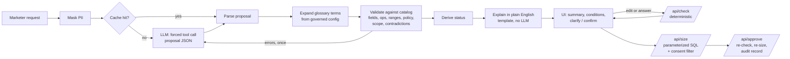

# Design note

## The one rule: the model proposes, deterministic code disposes

The model is good at one thing here: reading loose, sometimes Spanish, sometimes sloppy
language and mapping it to known fields. It is not trusted with anything that has a correct
answer: which fields exist, what "high value" means, whether consent applies, how many people
match, or what the summary says.

## Decisions and why

**1. The model fills a JSON schema; it never writes SQL.**
A forced tool call (`tool_choice` = `propose_audience`) means the response always parses into
`{conditions, glossary_terms, unmapped_phrases, channel, out_of_scope, assumptions}`. Column
names reach SQL only after validation against the catalog, and values are always bound
parameters. *Rejected: text-to-SQL.* It is more flexible, but every failure mode (wrong join,
missing consent, injection) becomes a SQL review problem the marketer cannot do.

**2. Glossary terms are named by the model and expanded by the server.**
For "high value customers" the model returns `glossary_terms: ["high_value"]`, not
`arpu_3m >= 40`. The server inserts the governed condition from `glossary.yaml`. The model
cannot drift a threshold, and changing the definition is a config change with an owner and a
decision id, not a prompt change. Open terms ("active", "churn risk") are never guessed: they
become a clarifying question with the competing definitions as options.

**3. Unmappable parts are surfaced, never dropped.**
The most dangerous model behaviour here is quietly ignoring the part it can't do: "premium
customers who called the call centre" becomes "premium customers". The schema has an
`unmapped_phrases` field, the prompt requires it, and approval is blocked until the marketer
explicitly accepts building without those parts.

**4. Status comes from the validator, not the model.**
`ready / needs_clarification / needs_confirmation / unsupported / invalid / ai_unavailable` is
derived from the validated result. The model saying it is done doesn't make it ready.

**5. One repair attempt, then stop.**
If validation fails (invented field, out-of-range value, a prepaid-only field on a postpaid
audience), the errors go back to the model once. A second failure goes to the human with the
reasons shown. Policy violations (restricted fields, consent) are not sent back: the request
itself is the problem, and the marketer should see the policy message. One retry bounds
worst-case latency and cost at 2× a normal request.

**6. The summary the marketer approves is generated by code.**
`explain.py` renders the validated definition with templates. A model-written summary could say
something slightly different from what will run, which is exactly what an approval step must not
allow.

**7. Consent and grain are enforced by the engine, not by the request.**
The consent column for the chosen channel is added in `AudienceEngine.size()`, always. Consent
fields are `usage: system` in the catalog, so the validator rejects any attempt to target them.
At startup the engine checks that `profiles` is one row per `profile_id`. Counting distinct
people is the invariant everything else depends on, so a duplicated feed stops the service
rather than silently inflating every audience.

**8. Evaluate by outcome, not by form.**
The eval harness compares the *set of reachable lines* selected by the proposal and by the
expected definition. `usage_events_30d >= 1` and `> 0`, or `region != Capital` and `region in
(the other four)`, are the same audience and both pass. Comparing JSON would punish correct
answers and reward lucky string matches.

**9. Data-usage policy is evaluated per marketing action, not per field.**
A field is not simply "allowed" or "forbidden". `app_active_30d` comes from an app-analytics
SDK whose consent covers SMS service messages but not email marketing. So fields carry labels,
channels are marketing actions, and enabled policies deny labels for actions. This is the shape
of label-based governance in customer data platforms (labels → policies → marketing actions), so
it maps directly onto a platform's own policy service in a real rollout. Policy violations are
never sent back to the model for "repair": the request conflicts with policy, so the marketer
sees the policy id and decides.

**10. A rule is one owned sentence; its numbers are a versioned parameter set.**
"High value means a top revenue band" is a decision someone signs. "40 USD" is a parameter that
changes more often. Fusing them means every threshold change looks like a rule change, and
reviewing a rule means reading SQL. So the glossary holds the sentence, the owner and the
decision id, and the conditions reference `parameters.yaml` (version, effective date, owner,
approver). The split also makes change impact computable.

**11. The governance config is validated mechanically, with a receipt.**
At startup (and with `make lint`) the config is checked:
- glossary conditions reference real fields and parameters;
- labels and marketing actions exist;
- decided terms have an owner, a decision id and a one-sentence rule;
- open terms have options and a named decider;
- consent fields are policy-blocked from targeting.

Errors stop the service. Warnings are the governance backlog. The receipt
(`governance lint: 0 errors, 0 warnings`) is in `/healthz`.

**12. Approvals snapshot their governance, so changes have a computable blast radius.**
Each approved audience stores the governed terms it relied on with their decision and parameter
versions. The audit list compares that snapshot with the current config. It flags audiences
whose rules changed (or whose interim choice for an open term has since been decided), and
re-sizes each one under the current definitions. A threshold change becomes a visible, reviewable
event instead of a silent shift in who gets the next campaign.

**13. What the model can't express is counted, not discarded.**
Unmapped phrases, clarification questions and marketers' corrections are already in the audit
trail. `/api/insights` aggregates them into:
- fields the data team should add (demand);
- open terms the business should settle first, with the choices people actually made;
- fields where the AI's mapping keeps getting corrected (prompt or catalog fixes).

That is the field-to-product loop, built from data the system already records.

**14. Model use is bounded.**
Requests are capped at 500 characters, outputs at 1,024 tokens, and repairs at one. The one
endpoint that calls the model has a per-client token-bucket rate limit (HTTP 429 with
Retry-After). A daily model budget switches the assistant off when spent; the deterministic
editor keeps working. These are the OWASP LLM10 (unbounded consumption) mitigations sized for a
single-team tool.

## Where the time goes (and why that shapes the design)

| Stage | Typical | Notes |
|---|---|---|
| PII masking, validation, explanation | < 1 ms | pure Python |
| Sizing, 200k lines | 3–8 ms | DuckDB, `scripts/bench.py` |
| Sizing, 5M lines | 17–47 ms p50 (p95 ≤ 55 ms) | same query, columnar scan |
| Model call | see README eval results | dominates end-to-end latency and all of the cost |

So the levers are on the model side: response cache (identical normalized requests), prompt
caching of the static catalog, glossary block (most input tokens), the smallest model that
passes the eval bar, and the repair cap.

## Scaling path (not built)

- **Profile store at CDP scale (hundreds of millions of profiles):** interactive previews from
  pre-aggregated cubes or approximate distinct counts (HyperLogLog sketches merge across
  segments; plain distinct counts don't add). Exact counts only at approval. Membership
  materialised asynchronously.
- **Many tenants:** catalog and glossary per tenant (already config, versioned, stamped on every
  record); cache keys already include both versions.
- **Throughput:** the API is stateless apart from SQLite (audit) and the in-memory cache. Swap to
  Postgres and Redis, run N replicas, and put a per-tenant rate limit and token budget in front
  of the model call.
- **Model routing:** try the small model first, escalate to the larger model only when
  validation fails (instead of repairing with the same model). The eval harness gives the data
  to decide whether that is worth it.
